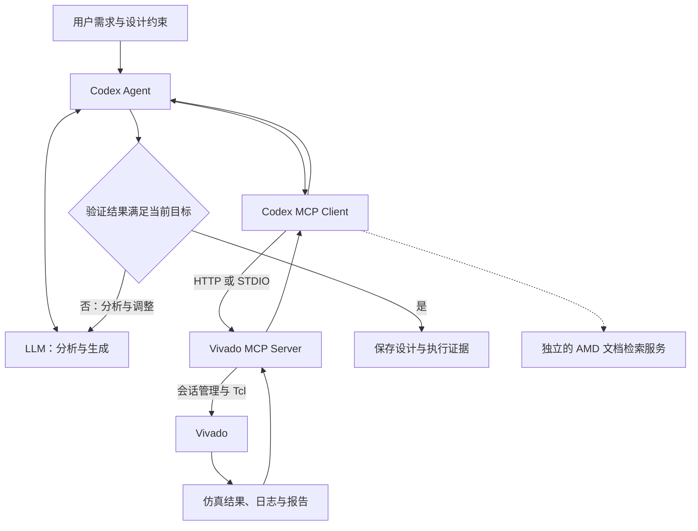

# LLM、MCP 与 Vivado 学习笔记

本文说明核心组件、Vivado 设计流程，以及 Windows 下 VS Code + Codex 的连接方法。更新日期：2026-11-11。独立计数器实验见 [Vivado 入门实验](Vivado入门实验.md)；研究实施路线仍以 [毕设完整实施路线图](00_毕设完整实施路线图.md) 为准。

路径、端口和工具参数必须与本机实际状态核对。安装扩展、注册 MCP、启动 Vivado、完成实验是不同的验收层级。

## 0. 核心概念速览

- **LLM** 理解需求、生成代码、分析报告并提出修改建议。
- **Agent** 围绕模型组织工具调用、文件操作、状态、验证和执行记录。Codex 是本教程使用的 Agent。
- **MCP** 是客户端与工具服务交互的协议，约定初始化、能力发现和调用方式。
- **MCP Server** 暴露具体能力。Vivado MCP Server 将请求转为 Vivado 会话操作和 Tcl 命令。
- **Vivado** 执行仿真、综合、布局布线和报告生成；执行结果由工具与测试提供证据。
- **反馈闭环** 是“提出设计 → 执行验证 → 分析结果 → 调整设计”。连通工具只是前提，不能据此认定已实现设计优化。

## 1. 核心组件与职责

### 1.1 组件分工

| 组件 | 主要职责 | 结果边界 |
| --- | --- | --- |
| LLM | 理解规格，生成 RTL/Tcl，解释反馈 | 生成内容仍需编译、测试和工具验证 |
| Agent | 安排步骤，调用模型和工具，记录状态 | 必须检查真实返回值，不能用语言补全执行结果 |
| MCP Host / Client | 承载交互、建立连接、发现并调用服务能力 | 只能使用当前环境已暴露的能力 |
| MCP | 规定客户端与服务端的消息交互 | 不负责 FPGA 优化算法或电路正确性 |
| Vivado MCP Server | 管理会话、执行 Tcl、读取日志和状态 | 依赖实际 Vivado、许可证、器件支持和工程状态 |
| Vivado / Tcl | 运行 EDA 流程和查询设计数据 | 成功完成某阶段不等于整个设计已通过验证 |
| Skills | 提供可复用的任务方法和操作规则 | 不代替工具执行，也不自动成为所有客户端的可用技能 |
| RAG / 文档检索 | 为模型补充手册、命令和设计知识 | 检索到说明不代表本机已支持或已执行 |

### 1.2 MCP 的能力原语

MCP 可提供 **Tools**（可调用操作）、**Resources**（可读取资料）和 **Prompts**（服务提供的提示模板）。实际支持哪些能力，以服务初始化和发现结果为准。Vivado 的核心需求是会话管理与 Tcl 执行工具。

GUI 自动化通过界面操作软件；Tcl 自动化使用 Vivado 命令；MCP 将这些工程能力封装为 Agent 可发现的接口。扩展、API、MCP 和 Skills 分别承担编辑器集成、程序接口、协议交互和流程指导，职责可以配合。

## 2. 技术架构与调用流程

### 2.1 工具调用架构



图中是期望建立的调用闭环，不表示本项目已经完成该系统。

### 2.2 单次调用过程

以查询 Vivado 版本为例：Codex 初始化 MCP 连接并发现真实工具 → 调用 `vivado_start` → 获得 `session_id` → 用 `vivado_execute` 在该会话执行 `version` → 读取结果和日志 → 检查返回版本是否符合预期。工具调用失败时应保留错误并定位原因。

对已有设计执行 `report_timing_summary` 前，还必须确认打开了正确的综合后或实现后设计，并检查约束。报告的含义取决于设计阶段和约束有效性。

### 2.3 传输方式与端口边界


Codex Agent 通过 MCP Client 调用 MCP Server 提供的工具，MCP 规定工具发现、调用及结果返回的交互方式。当前链路使用 HTTP 传输 MCP 消息，HTTP 基于 TCP/IP 通信。Vivado MCP Server 再通过 Tcl 接口调用 Vivado，并将执行结果沿原链路返回 Codex。MCP 也支持 STDIO，采用该方式时不需要 HTTP/TCP。

| 方式 | 运行关系 | 本文用途 |
| --- | --- | --- |
| Streamable HTTP | 客户端连接已经运行的 HTTP MCP 服务 | 优先复用扩展启动的 `http://127.0.0.1:18090/mcp`，实际地址以日志为准 |
| STDIO | 客户端启动本地服务进程，以标准输入输出交换消息 | HTTP 方案不可用时，按 AMD 官方指南改用独立 Server |

`18090/mcp` 是 MCP 入口。扩展的 WebSocket 连接、Server 内部管理端口和 Vivado 会话的 Tcl Web Server 不是同一层。不能把任意监听端口都填入 Codex 的 MCP URL，也不能用某条 WebSocket Connected 日志代替 MCP 验证。

## 3. Vivado 设计流程

### 3.1 设计阶段与验证证据


| 阶段 | 输入与输出 | Codex 可协助的工作 | 成功判定 |
| --- | --- | --- | --- |
| 规格与器件 | 功能、接口、时钟、实际 part | 梳理要求、查询支持范围 | 器件、工具和约束来源明确 |
| RTL | Verilog/SystemVerilog 源码 | 生成、审查、修改代码 | 位宽、复位、时钟与可综合性符合规格 |
| Simulation | RTL + Testbench → 行为与波形 | 编写自检、调用仿真、分析失败 | 自检通过、无致命错误，覆盖关键边界 |
| Synthesis | RTL + 约束 → 网表 | 调用综合、分析资源与警告 | Run 完成且设计结构符合预期 |
| Implementation | 网表 + 器件 + 约束 → 放置和布线结果 | 执行优化、布局、布线 | Run 完成并审查 DRC 和布线状态 |
| Timing analysis | 时钟、I/O 约束与当前设计 → 时序报告 | 提取违例、定位关键路径 | 同时检查约束覆盖、setup、hold 等项目 |
| 板级验证 | 已满足条件的实现结果与实际硬件 | 协助部署和整理测量记录 | 以实际硬件测试为准；本文实验不烧录 |

### 3.2 常用术语与比较条件

**RTL** 是寄存器传输级描述；**Testbench** 是只用于仿真的激励与检查程序；**XDC** 定义时钟、I/O 和物理约束。**LUT、FF、BRAM、DSP** 是 FPGA 资源类型。**WNS/TNS** 表示 setup 检查的最差裕量与负裕量合计，hold 还需检查 **WHS/THS**。**QoR** 表示设计结果质量，**PPA** 指功耗、性能和面积。

综合使用的连线延迟与布线后的实际延迟不同。比较时固定器件、RTL、XDC、工具版本和流程设置，并标注报告阶段。WNS 非负不能单独证明设计完整正确；未约束路径、错误例外和缺失 I/O 约束都可能使结论失真。

## 4. Vivado AI Extension

### 4.1 扩展提供的能力

本项目使用的包为 `vivado-ai-extension-2026.10.1.vsix`，本机已安装同版本扩展。已核对其 `package.json`、README 和随包 MCP 指南。扩展包含 Windows/Linux MCP Server、会话视图、Vivado Terminal、Tasks、Tool Call Dashboard 和 AMD Skills 支持。第三方安装包保留在本地并由 `.gitignore` 排除。

| 工具 | 用途 |
| --- | --- |
| `vivado_list_sessions` | 查看已有会话与实际版本 |
| `vivado_start` | 在指定工作目录启动新会话 |
| `vivado_execute` | 在指定会话执行 Tcl |
| `vivado_status` | 检查会话健康状态和 Run 进度 |
| `vivado_log_messages` | 查看错误、严重警告和警告 |
| `vivado_history` | 查看命令历史 |
| `vivado_connect` | 连接满足条件的既有会话 |
| `vivado_stop` | 结束指定会话，使用前确认归属 |

实际工具及参数以当前 Server 的发现结果为准。`vivado_doc_search` 属于独立的 `amd-doc-search` 服务，不能因 Vivado MCP 可用而推断 Codex 也已接入文档检索。

### 4.2 版本和平台要求

该版本扩展 README 要求 **Vivado 2020.2 或更新版本**，随包接入指南以 **2026.1** 为测试基准。

扩展包声明 VS Code 核心兼容范围从 1.85 开始；README 将 1.114 及以上列为包含 Skills 视图的完整体验。Windows 不支持包中 Linux 专用的虚拟显示、LSF、SSH 会话能力。Skills 是否被 Codex 加载需要另外检查，不能直接沿用其他客户端的集成结论。

### 4.3 官方来源与日志依据

扩展和独立 Server 从 [AMD Ross 官方下载页](https://www.amd.com/en/support/downloads/ross-agentic-ai.html) 获取。接入方式参阅 [AMD MCP 指南](https://github.com/Xilinx/ross-ai-assistant/blob/main/docs/getting-started/vivado-mcp.md)，工具说明参阅 [AMD MCP 工具参考](https://github.com/Xilinx/ross-ai-assistant/blob/main/docs/reference/vivado-mcp-tools.md)。版本相关设置以本机已安装包为准。

扩展创建 HTTP server definition、连接 WebSocket 或显示自身 Connected，只是对应层的证据；Codex 的初始化、工具发现和 Tcl 调用仍需分别验证。

## 5. 环境配置与连接验证

本章按本机 Windows + VS Code + Codex 的实际流程整理，使用 Vivado 2026.1、Vivado AI Extension 2026.10.1 和 HTTP MCP。

### 5.1 Vivado 安装检查

1. 从 [AMD 官方下载入口](https://www.amd.com/en/support/downloads/adaptive-socs-and-fpgas.html) 选择 Vivado 2026.1，登录账户并下载 Windows 安装器。
2. 运行安装程序；使用离线包时先解压并运行 `xsetup.exe`。选择 Vivado、所需仿真组件和目标器件系列，确认许可协议、安装目录和磁盘空间后安装。
3. 安装完成后，在 VS Code 的 **Terminal → New Terminal** 中打开 PowerShell，检查本机启动器：

```powershell
Test-Path "D:\2026.1\Vivado\bin\vivado.bat"
& "D:\2026.1\Vivado\bin\vivado.bat" -version
```

`Test-Path` 应返回 `True`，版本查询应输出 `v2026.1` 和 Build 信息。路径不存在时先核对实际安装位置；`&` 用于执行带引号的程序路径。

需要图形界面时，从 Windows 开始菜单启动 Vivado 2026.1。在 **Help → Manage License** 或开始菜单的 **Vivado License Manager** 中检查授权、有效期及所需功能；版本查询成功不能代替许可证检查。

### 5.2 Vivado AI Extension 配置

本机已安装扩展 **2026.10.1**，无需重复安装。首次配置的操作如下：

1. 从 [AMD Ross 官方下载页](https://www.amd.com/en/support/downloads/ross-agentic-ai.html) 获取可信的 VSIX，并核对版本与校验值。
2. VS Code 按 **Ctrl+Shift+X → Extensions 右上角 … → Install from VSIX…**，选择 VSIX，按提示重新加载并确认扩展已启用。
3. 按 **Ctrl+Shift+P → Vivado AI: Configure Install Path**，选择 `D:\2026.1\Vivado\bin\vivado.bat`。
4. 在 **Ctrl+, → User** 搜索 `vivadoAI`，或通过 **Preferences: Open User Settings (JSON)** 检查用户设置。
5. 执行 **Vivado AI: Show Connection Status** 检查状态；确认 Server 停止时，用 **Vivado AI: Start/Stop MCP Server** 启动。该命令是切换操作，不要在已运行时反复执行。
6. 打开 **View → Output → Vivado MCP**，查看启动信息及错误，确认 HTTP MCP 地址。

用户设置片段：

```json
{
  "vivadoAI.vivadoPath": "D:\\2026.1\\Vivado\\bin\\vivado.bat",
  "vivadoAI.autoRegisterMcp": true
}
```

将这些属性合并到已有的 **用户设置**，不要覆盖整个设置文件。`autoRegisterMcp` 向 VS Code 注册服务，不等于向 Codex 注册。

本机 HTTP MCP 地址：

```text
http://127.0.0.1:18090/mcp
```

如果连接异常，先检查扩展是否启用、Server 是否启动以及日志中的实际地址；需要重连时使用 **Vivado AI: Reconnect to MCP Server**。

### 5.3 Codex MCP 连接

VS Code 的 MCP 注册与 Codex 的 MCP 注册不一定相同。Codex CLI 和 Codex VS Code 扩展共享 Codex 配置机制，但仍需确认当前 Codex 会话实际连接了该服务，参阅 [OpenAI MCP 文档](https://developers.openai.com/codex/mcp)。

本机此前已执行 `codex mcp add vivado-mcp --url http://127.0.0.1:18090/mcp`，本次只检查现有配置，不重复添加：

```powershell
codex mcp list
codex mcp get vivado-mcp
```

核对以下三项：

- **名称**：`vivado-mcp`。
- **URL**：`http://127.0.0.1:18090/mcp`，传输为 `streamable_http`。
- **启用状态**：`enabled` 或 `enabled: true`。

配置不一致时先与扩展 Output 对照，只修正现有服务，保留其他配置。配置修改后重新开启 Codex 会话，必要时执行 **Developer: Reload Window**。

`codex mcp list` 能显示服务只证明配置存在，不能证明初始化、工具发现或 Tcl 执行成功。

### 5.4 连接验证

此前已确认 Vivado 2026.1 可运行，扩展 2026.10.1 已安装并配置，`vivado-mcp` 已注册到 Codex。MCP 端口最初没有监听，之后恢复监听，`Test-NetConnection` 已成功。

独立 MCP 诊断客户端也已完成初始化、发现 **11 个工具**，并成功调用 `vivado_list_sessions`。这证明当时客户端到 Server 的基本链路可用，**不能直接视为 Codex IDE 已完成实际 Tcl 调用验证**。

**步骤 1：Vivado 版本检查。** 执行 5.1 中的 `Test-Path` 和 `-version` 命令。

- **预期**：路径存在，输出 `v2026.1`，程序正常退出。
- **排查**：路径错误先核对安装位置；程序无法运行时查看启动错误，再继续连接检查。

**步骤 2：Extension 与 MCP Server 状态检查。** 在 **Output → Vivado MCP** 确认 Server 已启动、地址正确，再执行：

```powershell
Test-NetConnection 127.0.0.1 -Port 18090
```

- **预期**：`TcpTestSucceeded : True`，扩展日志无阻断性启动错误。
- **排查**：失败时先检查 Server 和实际端口，必要时重连扩展；不要仅因 Codex 已注册就跳过此步。TCP 成功也不等于 MCP 工具调用成功。

**步骤 3：Codex MCP 连接及工具发现。** 按 5.3 核对服务名称、URL 和启用状态。在 Codex VS Code 面板的新会话中，要求读取实际工具目录和 schema，并真实调用 `vivado_list_sessions`。

- **预期**：出现真实 MCP 调用记录和返回值；空会话列表也是合法结果。只列出几个工具名不算验证通过。
- **排查**：如果找不到工具或初始化失败，先查扩展 Output、Codex 的 MCP 错误及 URL，再重开 Codex 会话；不要重复添加同名服务。

**步骤 4：通过 Codex 调用 Vivado 执行 version。** 向 Codex 发出以下连接测试要求：

```text
请使用实际可调用的 Vivado MCP 工具进行连接验证：
1. 创建全新的临时工作目录，调用 vivado_start，以 general、Tcl 模式启动测试会话。
2. 记录返回的 session_id，并用 vivado_execute 在该会话执行 version。
3. 返回真实工具输出，用状态、日志或历史记录核对命令已完成。
只操作本次新建会话，不修改现有工程，不运行综合或实现，不关闭其他会话。
```

- **预期**：测试会话可查询，`version` 返回真实的 Vivado 2026.1 版本与 Build 信息；请求已受理或会话 ID 本身不算 Tcl 调用完成。
- **排查**：启动失败时检查安装路径、工作目录和启动日志；执行失败时核对 `session_id`、会话状态和 Tcl 错误。超时后先查状态，避免重复启动。

目前尚未取得这一步由 **Codex IDE** 发起并返回的实际 Tcl 验证证据，因此保持“待验证”，不写成已成功。计数器仿真、综合和实现操作见 [Vivado 入门实验](Vivado入门实验.md)。
