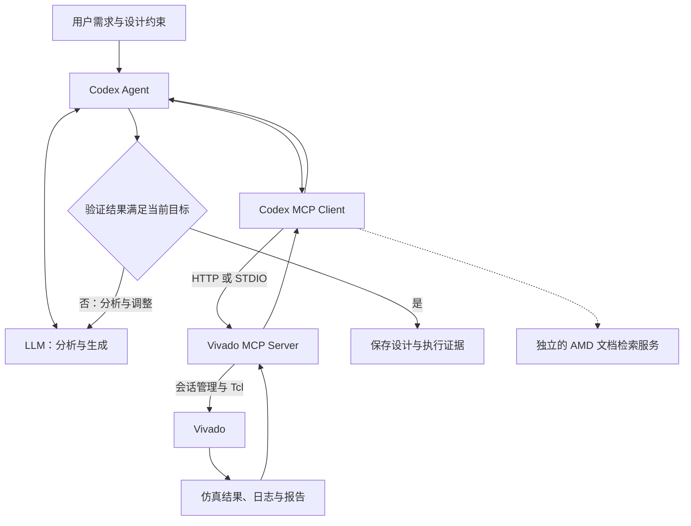

# LLM、MCP 与 Vivado 学习笔记

本文说明核心组件、Vivado 设计流程，以及 Windows 下 VS Code + Codex 的连接方法。更新日期：2026-11-11。独立计数器实验见 [Vivado 入门实验](Vivado入门实验.md)；研究实施路线仍以 [毕设完整实施路线图](00_毕设完整实施路线图.md) 为准。

路径、端口和工具参数必须与本机实际状态核对。安装扩展、注册 MCP、启动 Vivado、完成实验是不同的验收层级。

## 0. 核心概念速览

- **LLM** 理解需求、生成代码、分析报告并提出修改建议。
- **Agent** 围绕模型组织工具调用、文件操作、状态、验证和执行记录。Codex 是本教程使用的 Agent。
- **MCP** 是客户端与工具服务交互的协议，约定初始化、能力发现和调用方式。
- **MCP Server** 暴露具体能力。Vivado MCP Server 将请求转为 Vivado 会话操作和 Tcl 命令。
- **Vivado** 执行仿真、综合、布局布线和报告生成；执行结果由工具与测试提供证据。
- **反馈闭环** 是“提出设计 → 执行验证 → 分析结果 → 调整设计”。连通工具只是前提，不能据此认定已实现设计优化。

## 1. 核心组件与职责

### 1.1 组件分工

| 组件 | 主要职责 | 结果边界 |
| --- | --- | --- |
| LLM | 理解规格，生成 RTL/Tcl，解释反馈 | 生成内容仍需编译、测试和工具验证 |
| Agent | 安排步骤，调用模型和工具，记录状态 | 必须检查真实返回值，不能用语言补全执行结果 |
| MCP Host / Client | 承载交互、建立连接、发现并调用服务能力 | 只能使用当前环境已暴露的能力 |
| MCP | 规定客户端与服务端的消息交互 | 不负责 FPGA 优化算法或电路正确性 |
| Vivado MCP Server | 管理会话、执行 Tcl、读取日志和状态 | 依赖实际 Vivado、许可证、器件支持和工程状态 |
| Vivado / Tcl | 运行 EDA 流程和查询设计数据 | 成功完成某阶段不等于整个设计已通过验证 |
| Skills | 提供可复用的任务方法和操作规则 | 不代替工具执行，也不自动成为所有客户端的可用技能 |
| RAG / 文档检索 | 为模型补充手册、命令和设计知识 | 检索到说明不代表本机已支持或已执行 |

### 1.2 MCP 的能力原语

MCP 可提供 **Tools**（可调用操作）、**Resources**（可读取资料）和 **Prompts**（服务提供的提示模板）。实际支持哪些能力，以服务初始化和发现结果为准。Vivado 的核心需求是会话管理与 Tcl 执行工具。

GUI 自动化通过界面操作软件；Tcl 自动化使用 Vivado 命令；MCP 将这些工程能力封装为 Agent 可发现的接口。扩展、API、MCP 和 Skills 分别承担编辑器集成、程序接口、协议交互和流程指导，职责可以配合。

## 2. 技术架构与调用流程

### 2.1 工具调用架构



图中是期望建立的调用闭环，不表示本项目已经完成该系统。

### 2.2 单次调用过程

以查询 Vivado 版本为例：Codex 初始化 MCP 连接并发现真实工具 → 调用 `vivado_start` → 获得 `session_id` → 用 `vivado_execute` 在该会话执行 `version` → 读取结果和日志 → 检查返回版本是否符合预期。工具调用失败时应保留错误并定位原因。

对已有设计执行 `report_timing_summary` 前，还必须确认打开了正确的综合后或实现后设计，并检查约束。报告的含义取决于设计阶段和约束有效性。

### 2.3 传输方式与端口边界

| 方式 | 运行关系 | 本文用途 |
| --- | --- | --- |
| Streamable HTTP | 客户端连接已经运行的 HTTP MCP 服务 | 优先复用扩展启动的 `http://127.0.0.1:18090/mcp`，实际地址以日志为准 |
| STDIO | 客户端启动本地服务进程，以标准输入输出交换消息 | HTTP 方案不可用时，按 AMD 官方指南改用独立 Server |

`18090/mcp` 是 MCP 入口。扩展的 WebSocket 连接、Server 内部管理端口和 Vivado 会话的 Tcl Web Server 不是同一层。不能把任意监听端口都填入 Codex 的 MCP URL，也不能用某条 WebSocket Connected 日志代替 MCP 验证。

## 3. Vivado 设计流程

### 3.1 设计阶段与验证证据


| 阶段 | 输入与输出 | Codex 可协助的工作 | 成功判定 |
| --- | --- | --- | --- |
| 规格与器件 | 功能、接口、时钟、实际 part | 梳理要求、查询支持范围 | 器件、工具和约束来源明确 |
| RTL | Verilog/SystemVerilog 源码 | 生成、审查、修改代码 | 位宽、复位、时钟与可综合性符合规格 |
| Simulation | RTL + Testbench → 行为与波形 | 编写自检、调用仿真、分析失败 | 自检通过、无致命错误，覆盖关键边界 |
| Synthesis | RTL + 约束 → 网表 | 调用综合、分析资源与警告 | Run 完成且设计结构符合预期 |
| Implementation | 网表 + 器件 + 约束 → 放置和布线结果 | 执行优化、布局、布线 | Run 完成并审查 DRC 和布线状态 |
| Timing analysis | 时钟、I/O 约束与当前设计 → 时序报告 | 提取违例、定位关键路径 | 同时检查约束覆盖、setup、hold 等项目 |
| 板级验证 | 已满足条件的实现结果与实际硬件 | 协助部署和整理测量记录 | 以实际硬件测试为准；本文实验不烧录 |

### 3.2 常用术语与比较条件

**RTL** 是寄存器传输级描述；**Testbench** 是只用于仿真的激励与检查程序；**XDC** 定义时钟、I/O 和物理约束。**LUT、FF、BRAM、DSP** 是 FPGA 资源类型。**WNS/TNS** 表示 setup 检查的最差裕量与负裕量合计，hold 还需检查 **WHS/THS**。**QoR** 表示设计结果质量，**PPA** 指功耗、性能和面积。

综合使用的连线延迟与布线后的实际延迟不同。比较时固定器件、RTL、XDC、工具版本和流程设置，并标注报告阶段。WNS 非负不能单独证明设计完整正确；未约束路径、错误例外和缺失 I/O 约束都可能使结论失真。

## 4. Vivado AI Extension

### 4.1 扩展提供的能力

本项目使用的包为 `vivado-ai-extension-2026.10.1.vsix`，本机已安装同版本扩展。已核对其 `package.json`、README 和随包 MCP 指南。扩展包含 Windows/Linux MCP Server、会话视图、Vivado Terminal、Tasks、Tool Call Dashboard 和 AMD Skills 支持。第三方安装包保留在本地并由 `.gitignore` 排除。

| 工具 | 用途 |
| --- | --- |
| `vivado_list_sessions` | 查看已有会话与实际版本 |
| `vivado_start` | 在指定工作目录启动新会话 |
| `vivado_execute` | 在指定会话执行 Tcl |
| `vivado_status` | 检查会话健康状态和 Run 进度 |
| `vivado_log_messages` | 查看错误、严重警告和警告 |
| `vivado_history` | 查看命令历史 |
| `vivado_connect` | 连接满足条件的既有会话 |
| `vivado_stop` | 结束指定会话，使用前确认归属 |

实际工具及参数以当前 Server 的发现结果为准。`vivado_doc_search` 属于独立的 `amd-doc-search` 服务，不能因 Vivado MCP 可用而推断 Codex 也已接入文档检索。

### 4.2 版本和平台要求

该版本扩展 README 要求 **Vivado 2020.2 或更新版本**，随包接入指南以 **2026.1** 为测试基准。2018.3 不满足扩展 README 的版本下限，不能作为默认 MCP 教学环境。旧工程继续使用原版本；新环境单独检查，避免自动升级原工程或 IP。

扩展包声明 VS Code 核心兼容范围从 1.85 开始；README 将 1.114 及以上列为包含 Skills 视图的完整体验。Windows 不支持包中 Linux 专用的虚拟显示、LSF、SSH 会话能力。Skills 是否被 Codex 加载需要另外检查，不能直接沿用其他客户端的集成结论。

### 4.3 官方来源与日志依据

扩展和独立 Server 从 [AMD Ross 官方下载页](https://www.amd.com/en/support/downloads/ross-agentic-ai.html) 获取。接入方式参阅 [AMD MCP 指南](https://github.com/Xilinx/ross-ai-assistant/blob/main/docs/getting-started/vivado-mcp.md)，工具说明参阅 [AMD MCP 工具参考](https://github.com/Xilinx/ross-ai-assistant/blob/main/docs/reference/vivado-mcp-tools.md)。版本相关设置以本机已安装包为准。

扩展创建 HTTP server definition、连接 WebSocket 或显示自身 Connected，只是对应层的证据；Codex 的初始化、工具发现和 Tcl 调用仍需分别验证。

## 5. 环境配置与连接验证

### 5.1 Vivado 安装检查

#### 5.1.1 官方下载与版本选择

1. 打开 [AMD FPGA 开发工具下载入口](https://www.amd.com/en/support/downloads/adaptive-socs-and-fpgas.html)。需要复现旧工程时选择对应历史版本；本次新环境以计划使用的 2026.1 为例，不要求一律追随最新版。
2. 阅读所选版本的 Release Notes、Installation and Licensing（UG973），确认 Windows 版本、内存、磁盘空间、器件支持及许可要求。2018.3 的系统支持列表不包含后来的 Windows 11，不能从“能启动”推断为官方支持。
3. 按页面要求登录 AMD 账户，完成下载资格信息，下载 Windows 安装器。联网安装器按选择下载组件；完整离线镜像需先解压。校验页面提供的摘要或签名，避免使用来源不明的重打包安装器。
4. 明确需要完整 Vivado 设计工具与仿真组件。仅安装 Lab Edition、硬件管理组件或 VSIX，不能替代综合与实现环境。

安装步骤依据 [UG973 Installation Flow](https://docs.amd.com/r/en-US/ug973-vivado-release-notes-install-license/Installation-Flow)。具体界面和组件名称以所选版本为准。

#### 5.1.2 Windows 安装操作

1. 运行下载的 Windows 安装程序；离线包从解压目录运行 `xsetup.exe`。通过所需账户验证并阅读许可协议。
2. 选择 Vivado 产品及符合实际授权的版本，勾选所需设计工具、仿真器和目标器件系列。按板卡资料中的完整 part 决定器件系列，不必下载所有器件。
3. 选择独立的新版本目录，检查安装位置和临时目录的可用空间。可使用简短英文目录降低脚本路径问题，例如 `D:\2026.1\Vivado`；这是本机检查到的位置，不是安装器固定布局。
4. 核对安装摘要后执行安装，等待组件安装、运行库与快捷方式创建完成。只有驱动或系统组件确实要求时才按安装器提示提升权限。
5. 保留安装日志；遇到失败先定位下载、解压、权限或组件安装中的具体阶段，避免删除旧版本后重装。

旧路径 `D:\Vivado\2018.3` 和新版本目录可以并存。安装目录通常含 `bin`（启动器）、`data`（器件/IP 数据）、`lib`（运行库）等；`settings64.bat` 的位置随布局变化。真正配置给扩展的是已确认存在的 `bin\vivado.bat`，不是下载目录或安装器。

#### 5.1.3 路径、版本和启动检查

在 **VS Code → Terminal → New Terminal** 打开本机 Windows PowerShell，执行：

```powershell
$vivadoOld = 'D:\Vivado\2018.3\bin\vivado.bat'
$vivadoNew = 'D:\2026.1\Vivado\bin\vivado.bat'
Test-Path -LiteralPath $vivadoOld
Test-Path -LiteralPath $vivadoNew
Get-Command vivado, vivado.bat -ErrorAction SilentlyContinue |
    Select-Object Name, Source
```

前两项只证明文件存在；`Get-Command` 显示 PATH 当前会选中的版本，未找到时仍可用绝对路径。找不到新路径时，在**已知安装根目录**内搜索，避免全盘搜索：

```powershell
$installRoot = 'D:\2026.1' # 换成安装摘要中的实际位置
Get-ChildItem -LiteralPath $installRoot -Filter vivado.bat -File -Recurse `
    -ErrorAction SilentlyContinue | Select-Object FullName
```

在临时目录执行版本检查，避免把启动日志写进研究工程：

```powershell
$checkDir = Join-Path $env:TEMP ('vivado-check-' + (Get-Date -Format 'yyyyMMdd-HHmmss'))
New-Item -ItemType Directory -Path $checkDir -ErrorAction Stop | Out-Null
Push-Location -LiteralPath $checkDir
try {
    if (-not (Test-Path -LiteralPath $vivadoNew)) { throw 'Vivado path not found' }
    & $vivadoNew -version
    if ($LASTEXITCODE -ne 0) { throw 'Vivado version check failed' }
} finally {
    Pop-Location
}
```

**预期与判定：**输出对应 Vivado 版本和 Build，进程正常退出；输出 2018.3 表示选中了旧版本。PowerShell 的 `&` 用于执行带引号的路径，不能只输入路径字符串。

图形启动可用 Windows 开始菜单中的对应版本 **Vivado** 快捷方式，或在独立工作目录执行 `& $vivadoNew -mode gui`。Tcl 模式使用 `& $vivadoNew -mode tcl`，进入后输入 `version`，退出本次手动测试用 `exit`。版本检查、GUI/Tcl 启动、实际许可检出需分别确认。

#### 5.1.4 许可证与器件支持

从开始菜单打开对应版本的 **Manage Xilinx Licenses / Vivado License Manager**，或在 Vivado 的 **Help → Manage License** 查验可用许可证、有效期、版本范围及服务器连接。界面名称以版本为准。按所选器件、功能和 IP 检查授权，不假设旧许可证自动覆盖新版本。

在 Vivado Tcl Console 中查询真实器件：

```tcl
version
puts "Installed part count: [llength [get_parts]]"
set target_part {REPLACE_WITH_ACTUAL_PART}
if {[string match REPLACE_* $target_part]} {
    error {Set target_part from the actual device or board documentation}
}
set matched_parts [get_parts -quiet $target_part]
puts $matched_parts
if {[llength $matched_parts] != 1} { error {Target part is not uniquely available} }
```

将占位符换成实际完整器件名后，唯一匹配才说明安装支持该 part；这不证明相关 IP 和综合许可均有效。许可证最终还应结合后续真实 Run 的 checkout 日志判断。缺少器件时用开始菜单的 **Add Design Tools or Devices** 修改对应版本安装，参阅 [UG973 增加组件说明](https://docs.amd.com/r/en-US/ug973-vivado-release-notes-install-license/Adding-Additional-Tools-and-Devices)。

#### 5.1.5 安装异常定位

| 现象 | 检查与处理 |
| --- | --- |
| 安装器下载失败或停滞 | 核对 AMD 登录、网络/代理、下载资格和剩余空间；保留安装器错误与日志，使用官方下载选项重试失败部分 |
| 只有安装包，找不到启动器 | 确认是否完成安装、是否选了完整 Vivado、实际安装目标位置；下载完成不能代替安装完成 |
| 缺 DLL、程序闪退 | 查该版本 UG973 系统支持、安装完整性及运行库安装日志；不要从随机网站复制 DLL |
| 终端启动旧版本 | 查看 `Get-Command` 和 PATH，改用新版本绝对路径；重开终端/VS Code 使环境更新生效 |
| License checkout failed | 核对授权版本、器件/IP 功能、到期时间、许可证服务器及本机环境；不要把许可证内容提交 Git |
| 器件列表无目标型号 | 核对完整 part 拼写、版本支持及已安装 device family，再增装器件包 |
| 旧工程提示升级 | 保持原工程原版本；要评估新版时先建独立副本，不在原工程直接升级 IP |

### 5.2 Vivado AI Extension 配置

#### 5.2.1 获取与安装扩展

从 [AMD Ross 官方下载页](https://www.amd.com/en/support/downloads/ross-agentic-ai.html) 获取对应 VSIX，核对版本和页面校验值。不能仅凭本地文件名认定来源可信。本机已经安装 `AMD.vivado-ai-extension` 2026.10.1，无需重复安装。

首次安装时：**Ctrl+Shift+X → Extensions 右上角 … → Install from VSIX… → 选择 VSIX → 按提示重新加载**。也可在本机终端执行：

```powershell
code --install-extension 'D:\Downloads\vivado-ai-extension-2026.10.1.vsix'
code --list-extensions --show-versions | Select-String 'vivado'
```

下载路径是示例。第二条应显示实际扩展 ID 和版本；安装成功仍需检查启用状态。扩展详情页确认它在当前窗口已启用；Remote-SSH、WSL、容器窗口要核对扩展运行主机，Windows 的 `127.0.0.1` 与其他执行环境可能不同。

#### 5.2.2 用户设置与 Vivado 路径

打开 **Ctrl+,**，选 **User**，搜索 `vivadoAI`。执行 **Ctrl+Shift+P → Vivado AI: Configure Install Path**，选择已通过 `-version` 验证的启动器。也可用 **Preferences: Open User Settings (JSON)**，在已有 JSON 对象中合并以下属性：

```json
{
  "vivadoAI.vivadoPath": "D:\\2026.1\\Vivado\\bin\\vivado.bat",
  "vivadoAI.autoRegisterMcp": true,
  "vivadoAI.registerDocSearch": true,
  "vivadoAI.defaultGuiMode": false
}
```

这只是设置片段，不能覆盖整个设置文件。`vivadoPath`、许可证及自定义环境等机器设置应放在 **User settings**；该版本扩展不允许工作区设置决定这些可执行路径。`autoRegisterMcp` 是向编辑器注册，不能据此推断已写入 Codex 配置。`registerDocSearch` 只控制扩展的独立文档检索注册。`defaultGuiMode: false` 使用 Tcl 会话，适合首次自动化验证。

#### 5.2.3 Server 状态与 Output 日志

1. **Ctrl+Shift+P → Vivado AI: Show Connection Status**，查看扩展连接状态。
2. 如果本次 Server 确实停止，运行 **Vivado AI: Start/Stop MCP Server** 启动；该命令是切换操作，服务正在运行时不要反复执行。
3. **View → Output**（通常 `Ctrl+Shift+U`），在下拉列表选择 **Vivado MCP**。记录启动失败、端口分配、HTTP URL、进程退出等信息。需要重连时先用 **Vivado AI: Reconnect to MCP Server**。
4. 如有编辑器注册，**Ctrl+Shift+P → MCP: List Servers** 可查看 VS Code 侧服务；Codex 侧仍按 5.3 检查。
5. **Vivado AI: Show Tool Call Dashboard** 查看具体调用的参数、结果和耗时；Vivado Terminal 查看 Tcl。扩展说明将工程日志放在工作目录下 `.vivado-ai/`，服务日志放在用户目录 `~/.vivado-ai/`；以当前会话显示的路径为准。

不要直接使用 **Kill All MCP Servers & Restart** 处理普通连接错误，它可能影响其他窗口的服务或任务。

#### 5.2.4 HTTP 地址与监听检查

先在 Output 中确认实际 HTTP MCP 地址。以下命令以现有配置为例：

```powershell
$mcpUrl = 'http://127.0.0.1:18090/mcp'
$mcpUri = [uri]$mcpUrl
$listeners = Get-NetTCPConnection -LocalPort $mcpUri.Port -State Listen `
    -ErrorAction SilentlyContinue
$listeners | Select-Object LocalAddress, LocalPort, OwningProcess
$listeners | ForEach-Object { Get-Process -Id $_.OwningProcess } |
    Select-Object Id, ProcessName
Test-NetConnection -ComputerName $mcpUri.Host -Port $mcpUri.Port `
    -InformationLevel Quiet
curl.exe --noproxy 127.0.0.1,localhost -i --max-time 5 $mcpUrl
```

监听和 TCP 成功只证明有进程接收连接，还需核对进程及路径。普通 GET 可能返回 `400`、`405`、`406`，也可能因保持流连接而超时；这些现象不能单独判定 MCP 握手失败或成功。MCP 客户端需要完成协议初始化、工具发现和调用，不能把 HTTP 200 当成完整验收。

| 异常 | 排查顺序 |
| --- | --- |
| Connection refused | 先查 Server 是否启动、日志实际端口、监听 PID；无监听时先修扩展，不改 Codex URL 碰运气 |
| 端口被占用 | 核对占用进程与扩展实际选用地址；不要终止不明进程，按日志确认的新地址更新现有配置 |
| 404 或协议错误 | 核对 `/mcp` 路径、HTTP 服务类型和实际端口，避免连到 WebSocket/Tcl 端口 |
| localhost 请求经过代理 | 检查代理及 `NO_PROXY`；诊断时对 loopback 绕过代理，不修改整个网络配置 |
| VS Code 断开但 Vivado 仍在运行 | 先查 Sessions 和日志并重连；不要重复启动相同任务或清理其他人的会话 |
| 新版启动器存在但会话启动失败 | 在相同主机验证 `-version`，再查启动目录写权限、许可证、扩展环境和详细日志 |

### 5.3 Codex MCP 连接

#### 5.3.1 CLI、IDE 与配置边界

Codex CLI 在终端运行；Codex VS Code 扩展提供 IDE 交互。两者支持 MCP，并共享 Codex 配置机制；前提是处于同一用户、配置目录及执行环境。VS Code 自动注册的 MCP 服务属于编辑器自己的配置，不等于 Codex 已注册。参阅 [OpenAI MCP 文档](https://developers.openai.com/codex/mcp) 和 [配置基础](https://developers.openai.com/codex/config-basic)。

Windows 默认用户配置为 `$env:USERPROFILE\.codex\config.toml`；设置 `CODEX_HOME` 时检查对应目录。还要检查受信任项目的 `.codex/config.toml` 等配置层，避免仅查看用户文件却忽略覆盖。不要把用户完整配置、认证信息或其他服务秘密复制进公开仓库。

#### 5.3.2 现有 vivado-mcp 检查

用户已执行过注册命令，本机也已检查到同名 HTTP 服务，因此优先执行只读查询：

```powershell
Get-Command codex -ErrorAction Stop | Select-Object Source
codex --version
codex mcp list
codex mcp get vivado-mcp
```

预期显示 `enabled`、`streamable_http` 及 `http://127.0.0.1:18090/mcp`。`Auth: Unknown` 或 `Unsupported` 不是一次真实调用的失败证明；本地 Server 是否要求认证以服务说明及实际响应为准，不应无故添加 API Key。

定位配置文件：

```powershell
$codexConfigRoot = if ($env:CODEX_HOME) {
    $env:CODEX_HOME
} else {
    Join-Path $env:USERPROFILE '.codex'
}
$codexConfigPath = Join-Path $codexConfigRoot 'config.toml'
Get-Item -LiteralPath $codexConfigPath
code $codexConfigPath
```

在编辑器中定位现有表，仅检查或按实际 URL 修改它：

```toml
[mcp_servers.vivado-mcp]
url = "http://127.0.0.1:18090/mcp"
```

**不要重复添加同名 TOML 表，不要覆盖其他服务。** 修改前用 `Copy-Item` 将用户配置备份到配置目录；不把备份放进研究仓库。只有未来另一台机器确认完全没有该条目时，才需要首次注册：

```powershell
# 仅用于确认不存在该服务的首次配置；本机本次不执行
codex mcp add vivado-mcp --url http://127.0.0.1:18090/mcp
```

该 HTTP 连接组合使用 Codex 支持的传输方式和扩展实际提供的地址；仍需实测兼容性，不能视为 AMD 对 Codex IDE 自动集成的保证。修改后在新 Codex 会话中重新加载配置；必要时 **Developer: Reload Window**。先让扩展 Server 运行，再启动客户端连接。

#### 5.3.3 实际发现与调用

在 Codex VS Code 面板的新会话中要求：读取实际工具目录和 schema，列出当前 Vivado 服务工具，然后**真实调用** `vivado_list_sessions`。工具可能带服务前缀，以当前目录为准。

成功证据应包括工具调用记录、参数、实际返回值；空会话列表是合法结果。仅输出几个熟悉的工具名不构成发现证明。之后按 5.4 创建隔离会话并运行 `version`，才覆盖 Vivado 执行链路。

长期操作需要结合 Server 的异步状态轮询，不能把“任务已受理”当成执行完成。必要时在现有表中调高 `startup_timeout_sec` 或 `tool_timeout_sec`，但先定位失败层；延长超时不能修复没有监听或错误 URL。

#### 5.3.4 HTTP 异常与官方替代方式

依次检查扩展日志与监听、Codex URL、loopback/代理、客户端实际执行主机、配置覆盖及工具过滤项。WSL/远程窗口中的 `127.0.0.1` 不能直接当成 Windows Server，需先验证对应环境的可达性。Codex Output 中检查初始化错误；CLI 日志通常在配置根目录的 `log/` 下，具体以当前版本为准。

HTTP 仍不可用时，AMD 官方指南提供独立 Server + Codex CLI 的 STDIO 接入。先从官方下载可信 Windows 二进制并检查其版本和帮助，再决定切换；不要在排障中同时启动两套服务争用资源。以下是**替代配置片段**，不能与现有同名 HTTP 表叠加：

```toml
# 仅在明确切换方案并备份配置后，替换现有 vivado-mcp 表
[mcp_servers.vivado-mcp]
command = 'D:\Tools\vivado-mcp-server-windows-amd64-2026.10.1.exe'
args = ["--stdio-bridge"]

[mcp_servers.vivado-mcp.env]
VIVADO_PATH = 'D:\2026.1\Vivado\bin\vivado.bat'
```

这里使用 TOML 单引号保存 Windows 路径，反斜杠无需双写。HTTP URL 是客户端地址；`VIVADO_PATH` 是独立 Server 启动 Vivado 的路径，两者不能混用。无需安装 GitHub Copilot 才能使用 Codex 的这条接入方式。

### 5.4 连接验证

#### 5.4.1 分层验收顺序

按顺序验证，前一层失败就记录原因并先修复该层。下表中的命令细节见 5.1～5.3；后四步必须在 Codex 中执行真实 MCP 调用。

| 步骤 | 操作方式 | 预期结果与成功标准 | 失败定位 |
| --- | --- | --- | --- |
| 1. 安装路径 | `Test-Path -LiteralPath $vivadoNew`，核对绝对路径 | 为 True，确为计划版本的 `bin/vivado.bat` | 查实际安装摘要和目录，不使用安装器路径 |
| 2. 版本与启动 | `& $vivadoNew -version`；在隔离目录启动 Tcl 并执行 `version` | 版本、Build 正确，能够进入 Tcl；仍需另验许可 | 查 PATH、系统支持、运行库和启动错误 |
| 3. 扩展状态 | 扩展详情确认启用；Show Connection Status；Output → Vivado MCP | 扩展已激活，Server 未报告启动失败，记录实际 URL | 核对扩展运行主机、用户设置和启动日志 |
| 4. 服务监听 | `Get-NetTCPConnection`、PID 核对、`Test-NetConnection` | 正确 Server 监听实际端口，客户端所在主机可达 | 查停止、端口变更/占用和环境边界；GET 不替代握手 |
| 5. Codex 配置 | `codex mcp list`、`codex mcp get vivado-mcp` | 同名配置启用，传输与实际 URL 一致 | 查配置根目录、项目覆盖、TOML 重复表；不重复注册 |
| 6. 实际工具发现 | Codex 初始化连接、读取 schema 并调用 `vivado_list_sessions` | 有真实调用记录和可解释返回，即使列表为空 | 查 MCP 握手、工具过滤、客户端日志；不接受文字猜测 |
| 7. 测试会话 | 在新建隔离目录调用 `vivado_start`，使用 general、Tcl 模式 | 返回新 `session_id`，状态/列表能查到对应工作目录与版本 | 查启动器、目录权限、许可、启动超时；先确认是否已创建，避免重复启动 |
| 8. 简单 Tcl | 对该 ID 调用 `vivado_execute` 执行 `version` | 返回真实 Vivado 版本；请求受理后要等执行完成 | 查 ID、会话存活、busy 状态和 Tcl 错误 |
| 9. 证据交叉核对 | `vivado_status`、`vivado_log_messages`、`vivado_history` 与日志文件 | 会话健康、历史包含命令、版本与本机一致，错误有解释 | 查工具输出截断、错误日志和时间戳；保存原始失败，不填造结果 |

#### 5.4.2 隔离目录与工具参数示例

用 PowerShell 创建一个全新的目录，记录返回路径：

```powershell
$connectionDir = Join-Path $env:TEMP ('vivado-mcp-check-' + (Get-Date -Format 'yyyyMMdd-HHmmss'))
New-Item -ItemType Directory -Path $connectionDir -ErrorAction Stop | Out-Null
$connectionDir
```

让 Codex 从实际 schema 确认参数后调用。以下 JSON 是工具参数示例，不是 PowerShell 命令，也不是已经执行的返回结果。替换工作目录为上一步真实路径：

```json
{
  "working_dir": "D:/fpga-labs/connection-check-unique",
  "session_type": "general",
  "gui_mode": false
}
```

获取新会话 ID 后，对 `vivado_execute` 使用：

```json
{
  "session_id": "REPLACE_WITH_RETURNED_SESSION_ID",
  "command": "version"
}
```

接着单独执行 `puts [pwd]` 检查工作目录，并用状态、日志和历史工具核对。只在本次新建会话中操作；完成后如需停止，仅停止该 ID，不使用全局清理或关闭其他会话。

#### 5.4.3 本次文档整理时的检查记录

以下为 2026-11-11 的本机检查快照，后续安装和启动状态可能变化：

| 检查项 | 已取得的证据 | 尚未证明的事项 |
| --- | --- | --- |
| 旧版本 | `D:\Vivado\2018.3\bin\vivado.bat` 存在，`-version` 返回 v2018.3 | 不代表它满足本扩展的版本要求 |
| 新版本 | `D:\2026.1\Vivado\bin\vivado.bat` 存在，`-version` 返回 v2026.1 | 尚不能据此证明目标器件许可、仿真和实现可用 |
| 编辑器与扩展 | VS Code 1.145.2；Vivado AI Extension 2026.10.1 已安装，用户设置已指向新版路径 | 安装记录不能代替扩展当前运行状态 |
| Codex | CLI 0.147.0；`vivado-mcp` 已启用，传输为 streamable_http，URL 为 `http://127.0.0.1:18090/mcp` | 列表成功不代表在线 |
| MCP 入口 | 初查无监听；后续已监听。独立诊断客户端完成 HTTP MCP 初始化，发现 11 个实际工具，并成功调用 `vivado_list_sessions` | 独立客户端测试不等于 Codex IDE 已验证；尚未获得 Codex 创建测试会话和 MCP Tcl `version` 的返回证据 |

因此目前已确认文件、版本查询、配置和独立客户端到 MCP Server 的基本链路。Codex IDE 到新 Vivado 会话的端到端验证及计数器实验仍须按本节与独立教程继续执行；本文不声称它们已经成功，也未改写现有 Codex MCP 配置。
