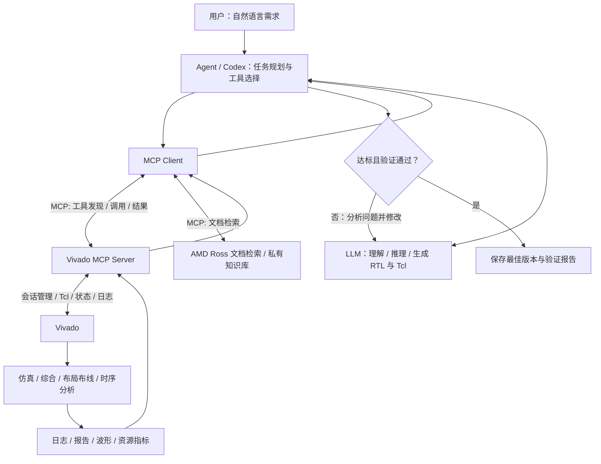
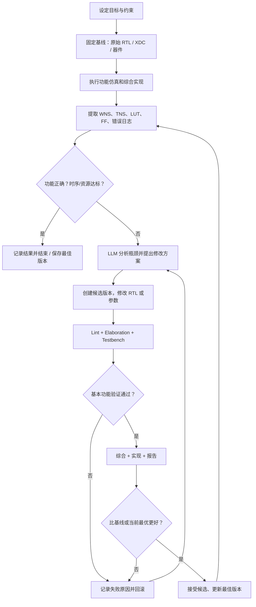

# LLM、Agent、MCP 与 Vivado：从原理到 FPGA 智能设计闭环

> **用途**：本科毕业设计《大模型驱动的 FPGA 智能设计方法研究》学习与实验笔记  
> **版本**：v1.0，2026-11-10  
> **适用场景**：Windows + VS Code + Codex + AMD Vivado 2026.1 + AMD Vivado AI Extension 2026.10.1  
> **说明**：本文基于用户提供的 VSIX 包内部说明、AMD 官方 Ross 文档和 MCP 规范整理。安装状态与工具调用结果必须在本机验证；本文中所有路径均为示例，未经验证的功能不视为已实现。

---

## 0. 先记住这六句话

1. **LLM（大语言模型）负责理解、分析、生成与决策**，它不会仅因为能聊天就自动掌握你的 Vivado 工程。
2. **Agent（智能体）是围绕 LLM 的执行系统**，通常负责规划任务、选择工具、记住中间状态、检查结果并反复行动。
3. **MCP（Model Context Protocol）是标准化连接协议**，让 Agent 发现并调用外部工具/数据源；它不是 FPGA 专用协议，也不是优化算法。
4. **Vivado MCP Server 是 MCP 的具体实现**，将 AI 的工具调用转换为启动 Vivado、执行 Tcl、读取日志和报告等操作。
5. **Vivado 是真正执行 EDA 工作的工具**：RTL 仿真、综合、布局布线、时序分析、资源统计、比特流生成等结果以实际工具为准。
6. **“能调用 Vivado”不等于“能可靠地优化 FPGA”**；真正的研究难点在于验证、报告理解、修改策略、回滚和可重复评测。

**一句话理解**：`用户提出需求 → Agent 调用 LLM 制订计划 → 经 MCP 请求 Vivado 执行 → Vivado 返回结果 → Agent 分析并决定是否继续修改。`

---

## 1. 概念与职责：它们到底有什么不同？

| 名称 | 中文理解 | 主要做什么 | 不负责什么 |
|---|---|---|---|
| **LLM** | 大语言模型，大脑中的语言与推理部分 | 理解自然语言、生成 Verilog/Tcl、解释日志、提出方案 | 本身不实际综合电路、不天然拥有本地文件和软件权限 |
| **Agent** | 智能体执行系统 | 管理目标、步骤、工具调用、文件、状态与重试 | 不能凭自身保证生成的 RTL 正确 |
| **MCP** | 模型上下文协议，通用连接规范 | 定义工具/资源/提示词的发现与调用方式 | 不负责运行 FPGA 算法或判断电路好坏 |
| **MCP Host / Client** | 使用 MCP 的 AI 应用及其客户端组件 | 与 MCP Server 建立会话、读取工具定义并发出调用 | 不是 Vivado 本身 |
| **MCP Server** | 工具适配服务 | 暴露 `vivado_execute` 等工具、执行请求、返回结果 | 不等于一个新的 EDA 引擎 |
| **Vivado/Tcl** | EDA 软件与命令接口 | 仿真、综合、实现、报告、生成比特流 | 不会自动理解自然语言的全部意图 |
| **Skills** | 可复用的工程方法/操作指南 | 告诉 Agent 如何规范做仿真、Lint、时序检查等 | 通常不是通信协议；不替代 MCP |
| **RAG/知识库** | 检索增强生成与参考资料 | 查器件手册、IP 文档、Tcl 命令和工程经验 | 不直接执行 Vivado 流程 |

### 1.1 关键区别：MCP 不是“接管鼠标”

可以说“**MCP 为 AI 操作 Vivado 提供接口**”，但更严谨的说法是“**MCP 让 AI 在授权范围内调用 Vivado 已暴露的功能**”。

- **GUI 自动化**：模拟点击按钮、输入文本；易受窗口布局影响。
- **Tcl 自动化**：Vivado 原生命令接口，可脚本化、可记录、便于复现。
- **MCP 工具调用**：把 Tcl、会话管理、日志读取等封装为 Agent 能发现和调用的工具；具体能力受 MCP Server 实现限制。

因此，MCP 可看作一种**标准插座**，而 Vivado MCP Server 是连接该插座与 Vivado Tcl 的**适配器**。

### 1.2 MCP 的三个主要原语

| 原语 | 意义 | FPGA 示例 |
|---|---|---|
| **Tools** | 可调用的操作 | 启动 Vivado、运行 Tcl、读取日志 |
| **Resources** | 可以读取的资料 | 工程配置、设计文档、结构化报告（取决于服务实现） |
| **Prompts** | 可复用的提示词模板 | “检查时序并形成分析报告”（取决于服务实现） |

MCP 通过客户端与服务端协商能力；**不是每个 MCP Server 都必须同时提供这三类功能**。

### 1.3 MCP 与 API、插件、Skills 的关系

- **API** 是宽泛的程序接口；**MCP** 是 AI 工具接入场景的一种通用协议约定。
- **VS Code Extension** 是编辑器插件，它可以自带 MCP Server、配置 UI 和工程工具。
- **Skills** 是“怎么做”的流程知识；**MCP Tools** 是“实际执行什么操作”的接口。二者经常配合。
- **RAG** 帮 AI 找到资料；**MCP** 可以提供访问 RAG 检索服务的方式，但不是 RAG 本身。

---

## 2. 技术架构：从聊天到 EDA 执行



**注意**：图中的“修改 → 再验证”是我们希望实现的**完整研究闭环**，并不意味着任何现成插件打开后就一定能自动稳定完成。

### 2.1 一次工具调用到底发生了什么？

假设你说：

> “请检查当前 FPGA 工程的时序。如果 WNS 小于 0，解释最严重的关键路径。”

1. **理解任务**：Agent 判断需要读取工程状态和时序报告。
2. **查询工具**：MCP Client 获取服务暴露的工具，如 `vivado_list_sessions`、`vivado_execute`。
3. **发起操作**：Agent 选择正确的 Vivado 会话，执行 `report_timing_summary`，必要时查询详细路径。
4. **EDA 执行**：Vivado 的 Tcl 引擎运行命令（必须有合适的已打开设计）。
5. **读取结果**：Vivado 返回报告；Agent 获取 WNS、TNS、违例路径及相关错误。
6. **形成判断**：Agent 将负裕量解释为时序不满足，建议分析逻辑深度、扇出、约束或物理路径。
7. **可选下一轮**：得到用户许可后，在工程副本中修改 RTL/约束并重新验证。

示意 Tcl 命令：

```tcl
# 前提：已打开综合后或实现后的设计
report_timing_summary -file timing_summary.rpt
report_utilization -file utilization.rpt
```

> **示例数据（虚构，仅教学）**：`WNS = -0.850 ns`、`TNS = -12.500 ns` 表示相应约束条件下存在违例。必须先核对时钟和 I/O 约束是否合理；不能仅以 WNS 为正就断言整个设计正确。

### 2.2 STDIO 与 Streamable HTTP 怎么选？

| 连接方式 | 工作原理 | 适用场景 |
|---|---|---|
| **STDIO** | Agent 启动一个本地进程，通过标准输入输出交换 MCP 消息 | 本地 CLI / Codex 手动注册 MCP Server |
| **Streamable HTTP** | Agent 通过 HTTP 地址连接 MCP Server | 已运行的本地服务、内网服务、远程文档检索 |

**一个本地 HTTP 地址不是“Vivado 的地址”**，而是 MCP Server 暴露给客户端的地址；Vivado 进程可能由这个 Server 进一步管理。不同进程的端口和安全边界要区分。

---

## 3. Vivado 原本就有哪些开发阶段？AI 可以参与哪些步骤？


| 阶段 | 主要输入 | Vivado/相关工具输出 | AI 可能做什么 | 必须留意 |
|---|---|---|---|---|
| 需求与器件选择 | 功能、频率、接口、板卡 | 器件与接口设计方案 | 查手册、设计架构 | 器件型号与板卡约束真实存在 |
| RTL 开发 | 设计规格 | Verilog/SystemVerilog | 生成模块、重构代码 | 可综合性、位宽、复位、时钟域 |
| 功能验证 | RTL、Testbench | pass/fail、波形 | 生成测试、分析失败 | Testbench 需要有覆盖率和有效断言 |
| 综合 | RTL、XDC | 网表、资源、早期时序 | 调用综合并看警告 | 综合通过不代表功能正确 |
| 布局布线 | 网表、器件、约束 | Routed Design | 启动实现、监视执行 | 实现可能耗时、需要许可证/磁盘空间 |
| 时序与资源 | 实现结果 | WNS/TNS/LUT/FF/BRAM/DSP | 识别瓶颈、提出优化 | 时序约束必须完整且正确 |
| 比特流与板测 | 已通过实现的设计 | `.bit`、板级行为 | 生成下载文件、协助调试 | 上板受硬件、接口、供电与板卡约束限制 |

**EDA 常见缩写**：

- **RTL**：寄存器传输级设计代码。
- **XDC**：时钟、管脚、电气等约束文件。
- **LUT**：查找表；**FF**：触发器；**BRAM**：片上块 RAM；**DSP**：DSP 运算资源。
- **WNS**（Worst Negative Slack / Worst Slack）：最差时序裕量；**TNS**（Total Negative Slack）：负裕量的合计。
- **QoR**：Quality of Results，综合考虑性能、面积、功耗等结果质量。
- **PPA**：Power、Performance、Area（功耗、性能、面积）。

**时序报告比较原则**：同一器件、同一约束、同一实现阶段、尽量相同工具版本和执行设置下比较。综合阶段的时序是估计，实现后（特别是布线后）的时序更接近最终硬件情况。

---

## 4. 你已经安装的插件，具体提供了什么？

本节不是猜测：已直接检查用户上传的 `vivado-ai-extension-2026.10.1.vsix` 文件，包括：

- `extension/package.json`
- `extension/readme.md`
- `extension/bin/vivado-mcp-server-windows-amd64-2026.10.1.exe`
- `extension/bin/vivado-mcp-server-linux-amd64-2026.10.1`
- `extension/resources/plugin-bundled/docs/getting-started/vivado-mcp.md`
- `extension/resources/plugin-bundled/docs/reference/vivado-mcp-tools.md`
- 内置 `skills/` 目录

### 4.1 它包含的主要工具

| 工具 | 作用 | 第一阶段是否需要 |
|---|---|---|
| `vivado_start` | 启动 Vivado 会话 | 需要 |
| `vivado_list_sessions` | 列出会话，获取 ID 和版本 | 需要 |
| `vivado_execute` | 在指定 Vivado 会话执行 Tcl | **最关键** |
| `vivado_status` | 查询会话和综合/实现运行状态 | 需要 |
| `vivado_log_messages` | 读取错误、严重警告和警告 | 需要 |
| `vivado_history` | 读取工具命令历史 | 建议 |
| `vivado_connect` | 连接已有的 Vivado 会话 | 按需 |
| `vivado_stop` | 停止指定会话 | 谨慎 |
| `vivado_doc_search` | 检索 AMD 官方文档 | 有用，但由**单独的** `amd-doc-search` MCP 服务提供 |

还包含其他工具，完整列表参阅插件内部的 `vivado-mcp-tools.md`，不应根据上表推断只有这些工具。

### 4.2 插件里已经有的 Skills（节选）

- `vivado-simulate-rtl`：RTL 仿真流程
- `vivado-rtl-lint`：RTL 静态检查
- `vivado-rtl-elaboration-analysis`：Elaboration 分析
- `vivado-timing-methodology-checks`：时序方法检查
- `vivado-revision-control`：设计版本相关流程
- `vivado-ip-configurator`：IP 配置方法
- 还有 HLS、Vitis 等技能，当前本科毕设不必全部使用。

**研究启示**：现成 Skills 已包含大量标准实践；毕业设计更值得研究“**怎样利用执行反馈选择修改方案，并保证修改有效**”，而不是重复编写一个简单的“打开 Vivado”工具。

### 4.3 版本与平台

- 你上传的扩展版本为 **2026.10.1**。
- 扩展 README 写明：Vivado **2020.2 及更新版本**；**2026.1 是主要测试基准**。
- VS Code **1.114+** 提供完整插件体验；更旧的部分 VS Code 版本可能只支持核心能力。
- Windows/Linux 都存在服务器二进制，但远程 SSH/LSF 等部分工具仅支持 Linux。
- 你正在下载安装 Vivado 2026.1；**在成功安装与运行前，不能把“已安装插件”当成“已打通 EDA”。**

### 4.4 VS Code 输出日志怎样理解？

之前截图里有：

```text
Created doc-search definition: amd-doc-search -> https://ross.amd.com/mcp/doc-search
Created HTTP server definition: vivado-mcp-server -> http://127.0.0.1:18090/mcp
WebSocket connected
```

这至少证明插件进程启动并创建 MCP 服务配置；**不能单凭这些日志证明 Codex 已连接、Vivado 已启动、Tcl 调用已成功**。必须做下一节的逐层验证。

---

## 5. 安装完成后，如何把 VS Code、Codex、MCP 和 Vivado 接起来？

### 5.1 建议的目录与基本检查

你的旧版本为 `D:\Vivado\2018.3`，建议把新版本放在不同目录（下面以实际安装完成后出现的路径为准）：

```text
D:\
├── Vivado\2018.3\                 # 旧版本，不覆盖
└── AMDDesignTools\
    └── Vivado\2026.1\            # 新版本；实际路径以安装结果为准
        └── bin\vivado.bat
```

Windows PowerShell 检查：

```powershell
Test-Path 'D:\AMDDesignTools\Vivado\2026.1\bin\vivado.bat'
& 'D:\AMDDesignTools\Vivado\2026.1\bin\vivado.bat' -version
```

若路径不存在，先到实际安装目录找 `vivado.bat`，**不要照抄示例路径**。下载完成不等于安装完成，确认程序可执行及许可证状态后再继续。

### 5.2 先配置 Vivado AI Extension

1. VS Code 按 `Ctrl + Shift + P`。
2. 运行 **`Vivado AI: Configure Install Path`**。
3. 指向上面确认存在的 `vivado.bat`。
4. 在 VS Code **Output → Vivado MCP** 查看日志。
5. `Ctrl + Shift + P` → **`MCP: List Servers`**，检查 Vivado 服务是否存在并且正常启动。

插件支持的设置项包括：

```json
{
  "vivadoAI.vivadoPath": "D:\\AMDDesignTools\\Vivado\\2026.1\\bin\\vivado.bat",
  "vivadoAI.autoRegisterMcp": true,
  "vivadoAI.registerDocSearch": true,
  "vivadoAI.defaultGuiMode": false
}
```

以上是 VS Code 的 `settings.json` **设置片段**，不要覆盖原来整个设置文件；应当合并属性。`defaultGuiMode: false` 表示优先 Tcl 模式，适合自动化；如果希望查看 GUI，可以按需要启动图形会话。

### 5.3 重要：VS Code 的 MCP 与 Codex 的 MCP 不一定是同一个配置

**路线 A（插件官方推荐的 VS Code 路线）**：Vivado AI Extension 自动将自带 MCP Server 注册到 VS Code 的 MCP 环境。使用 **GitHub Copilot Agent** 时可在“Configure Tools”中寻找 Vivado 工具，然后直接验证。

**路线 B（你目前使用的 Codex）**：Codex IDE 扩展与 Codex CLI 共用 `~/.codex/config.toml`。它不应被假设会自动读取所有 VS Code MCP 服务。必须独立确认它能否列出 Vivado MCP 工具。

先在终端检查：

```powershell
codex mcp list
```

如果 Codex 还没有相应服务，可以**尝试重用已运行的插件本地 HTTP MCP 地址**（此前日志中是 `127.0.0.1:18090`；**端口可能因设置或环境改变**）：

```powershell
codex mcp add vivado-mcp --url http://127.0.0.1:18090/mcp
codex mcp list
```

**这是针对当前 VSIX 已启动 HTTP MCP 的连接尝试，并非官方文档明确保证的 Codex + VSIX 自动集成路径。** 需验证实际 HTTP MCP 可用、端口正确、Codex 能发现工具。不要仅因 `mcp list` 有名字就判定调用成功。

如果上述方式不通：

- 按 [AMD 官方 Vivado MCP 指南](https://github.com/Xilinx/ross-ai-assistant/blob/main/docs/getting-started/vivado-mcp.md) 选用**独立 MCP Server 的 Codex STDIO 接入方案**。
- 官方建议 **IDE 的 VSIX 方案**与**独立 Server CLI 方案**择一使用，不要盲目同时启动两套相同服务。
- Codex 的 `config.toml` 是 TOML，不是 VS Code 的 `.vscode/mcp.json` JSON 格式。

Windows 独立 STDIO 的配置结构示意（**只有在明确切换到独立 Server 方案后使用；可执行程序需由官方可靠来源获得并确认路径**）：

```toml
[mcp_servers.vivado-mcp]
command = 'D:\Tools\vivado-mcp-server-windows-amd64-2026.10.1.exe'
args = ["--stdio-bridge"]

[mcp_servers.vivado-mcp.env]
VIVADO_PATH = 'D:\AMDDesignTools\Vivado\2026.1\bin\vivado.bat'
```

> 避免同时注册同名 HTTP 和 STDIO 服务；若切换方案，先清理旧配置再测试。独立 Server 不是必须安装的第二份 VS Code 插件。

### 5.4 逐层验收：每一步都明确“什么才算成功”

| 测试 | 提示或操作 | 成功标准 |
|---|---|---|
| T1 文件安装 | `Test-Path` 检查 `vivado.bat` | 返回 `True` |
| T2 Vivado 可运行 | `vivado.bat -version` | 输出 2026.1 或实际版本 |
| T3 MCP 服务器 | VS Code `MCP: List Servers` | 能看到 Vivado 服务、无启动错误 |
| T4 Codex 发现工具 | Codex 中请求列出 `vivado_*` | 显示**真实的**工具清单，而不是凭空编造 |
| T5 Vivado 会话 | Agent 调用 `vivado_start` | 返回会话 ID、可查询状态 |
| T6 Tcl 执行 | Agent 在正确会话中运行 `version` | 返回 Vivado 版本，执行记录可查 |
| T7 工程只读 | 打开**副本**，读取工程信息 | 设备型号、顶层、文件清单匹配 |
| T8 EDA 闭环 | 仿真、综合、实现、报告 | 关键文件和结果保存在实验目录、可复验 |

**建议首次发给 Codex 的提示词**：

```text
请先进行 Vivado MCP 只读连接验证：
1. 列出实际可调用的 MCP 服务和 vivado_* 工具，不要猜测；
2. 检查 Vivado 安装路径与版本；
3. 如果连接可用，使用 vivado_start 启动一个测试会话，获取 session_id；
4. 运行 Tcl 的 version 命令并返回工具的真实输出；
5. 告诉我每一步的成功/失败证据、日志位置与下一步建议。
禁止修改现有工程，禁止运行综合/实现，禁止停止其他会话。
```

---

## 6. 一个可以真正实现的最小实验：LED/计数器

不要一开始就让 AI 自动完成复杂 SoC。先从一个很小的、可重复验证的设计着手。

### 6.1 任务例子

> 设计一个具有同步复位和使能输入的 N 位计数器，要求在每个上升沿根据使能信号递增；编写 Testbench；确保仿真通过，然后进行综合、实现和时序分析。

**先确定工程条件**：实际 FPGA 器件型号、时钟频率、复位方式、工具许可证、目标板卡（若要上板）、以及有效 XDC 约束。

### 6.2 对 Agent 提出任务

```text
在一个全新的测试目录中创建最小 FPGA 工程，不要修改其他工程：
1. 编写参数化 N 位计数器 RTL；
2. 编写自检 Testbench，验证复位、使能、计数溢出等边界；
3. 通过 Vivado MCP 执行仿真，保存日志；
4. 仿真通过后再综合，并生成资源使用报告；
5. 确认器件与 XDC 正确后执行 Implementation；
6. 生成 post-route 的 Timing Summary；
7. 汇总每一步的命令、返回码、日志路径、WNS/TNS、LUT/FF；
8. 没有有效器件或约束时不要编造结果，停止在能够验证的阶段。
只操作测试目录，不生成或下载 bitstream 到实际板卡。
```

### 6.3 最终应该得到什么？

```text
fpga-llm-lab/
├── rtl/
│   └── counter.v
├── tb/
│   └── tb_counter.sv
├── constraints/
│   └── design.xdc
├── scripts/
│   ├── run_sim.tcl
│   ├── run_synth.tcl
│   └── run_impl.tcl
├── logs/
│   ├── sim.log
│   ├── synth.log
│   └── impl.log
├── reports/
│   ├── timing_summary.rpt
│   └── utilization.rpt
├── experiments/
│   └── baseline.json
└── README.md
```

这是**建议的项目结构**，并非 Vivado 会自动生成这些恰好同名文件。让 Agent/脚本负责保存和归档。

---

## 7. 从“能用工具”走向“能做研究”：智能优化闭环

这是你毕业设计最值得重点做的内容。



### 7.1 现成插件已经帮你解决什么？

- **连接问题**：工具发现、启动和会话管理。
- **执行问题**：调用 Tcl、读取状态、日志和工具输出。
- **参考资料问题**：通过文档检索服务查阅 AMD 知识。
- **部分工程流程**：通过内置 Skills 提供标准方法。

### 7.2 你真正需要额外设计什么？

以下按建议优先级排列。

| 优先级 | 研究模块 | 为什么重要 | 最小交付 |
|---|---|---|---|
| **P0** | **统一报告解析器** | 把自由文本日志变成机器可比较的数值 | `results.json`（success/WNS/TNS/LUT/FF/工具版本） |
| **P0** | **自动验证与回滚** | 防止 AI 越改越错；确保每个版本可恢复 | 验证门槛 + Git/快照 + 自动恢复 |
| **P0** | **实验基线与评测脚本** | 优化是否有效要有可比较的证据 | 同条件运行 baseline/candidate，输出对比表 |
| **P1** | **LLM 修改策略** | 这是模型“智能”的主要体现 | 根据错误类型/关键路径生成少量具体修改 |
| **P1** | **多轮搜索与候选选择** | 避免只做一次无依据的修改 | 限制迭代次数，保留最优候选 |
| **P1** | **知识库/文档检索增强** | 降低 Tcl、器件、约束知识的幻觉 | 给每项工程建议附依据 |
| **P2** | **多目标优化** | 性能好可能增加资源/功耗 | 性能与资源的 Pareto 或加权评估 |
| **P2** | **功耗与上板验证** | 更接近真实 FPGA 产品落地 | 在具备条件时追加功耗报告/板测 |
| **P2** | **自定义 MCP** | 研究标准化工具接口的扩展性 | 单独的 `eda_eval` / `compare_runs` MCP 工具 |

**重要提醒**：毕业设计是否有“创新点”，取决于已有工作调研、研究问题定义以及实验结果；不能因为用了 LLM + MCP 就直接声称创新。优先把研究范围收敛到**基于 EDA 反馈的可靠修改与验证策略**。

### 7.3 建议的结构化实验记录

```json
{
  "case_id": "counter_01",
  "candidate_id": "baseline",
  "vivado_version": "2026.1",
  "part": "<真实器件型号>",
  "constraint_hash": "<XDC文件SHA256>",
  "rtl_hash": "<RTL文件SHA256>",
  "sim_pass": true,
  "synth_pass": true,
  "impl_pass": true,
  "wns_ns": null,
  "tns_ns": null,
  "lut": null,
  "ff": null,
  "bram": null,
  "dsp": null,
  "runtime_s": null,
  "notes": "首次记录时先填真实结果，未知值保持 null"
}
```

上面是**数据格式示意**，不是已运行得到的实验结果；`null` 表示未知，禁止编造数据。真实评测还应记录 Run 策略、Seed（若适用）、主机配置、约束有效性与状态。

### 7.4 推荐的三组对照实验

| 实验组 | 方法 | 目的 |
|---|---|---|
| A：固定流程 | 固定 Tcl 脚本 + 人工指定 RTL | 建立基准运行和报告解析准确度 |
| B：LLM，无自动反馈 | AI 生成/修改 RTL，但不读取 EDA 结果循环优化 | 评估单次生成能力 |
| C：LLM + MCP 反馈闭环 | AI 读取真实报告，多轮修改 + 验证 | 检验反馈机制是否真正带来收益 |

三个组必须使用相同设计任务、器件、约束及可比较的运行条件。建议多个测试用例、重复运行并报告均值与波动，避免只展示最好的一次结果。

### 7.5 不要只追求 WNS

- **功能正确性**：仿真和必要的形式验证应先通过；生成错误设计即使 WNS 大幅改善也应判失败。
- **约束完整性**：缺失时钟、错误的 false path / multicycle path 等可能让 WNS 看起来很好，却不能代表真实设计更好。
- **资源成本**：LUT、FF、BRAM、DSP 的消耗可能上升。
- **执行成本**：EDA 运行时间、AI 调用次数、失败率和人工干预次数也是指标。
- **可复现性**：需要保存源文件、XDC、脚本、日志、版本和实验设置。

---

## 8. 建议的研究路线（从当前进度开始）

### 阶段 0：环境打通

- [ ] Vivado 2026.1 下载和安装完成。
- [ ] 真实 `vivado.bat` 路径确定，`-version` 正常。
- [ ] 许可证/目标器件支持确认。
- [ ] Vivado AI Extension 2026.10.1 能启动 MCP。
- [ ] Codex **真实**调用一次 `vivado_start` + `vivado_execute`。

### 阶段 1：单案例完整流程

- [ ] 使用最小 Counter/FIFO/UART 等设计。
- [ ] 正确生成 Testbench 并通过自检仿真。
- [ ] 完成综合与实现。
- [ ] 保存 WNS、TNS、LUT、FF 及相关报告。
- [ ] 固定脚本，人工重复运行一次，结果一致或可解释。

### 阶段 2：可信反馈闭环

- [ ] 编写报告解析器，避免让 LLM 仅靠长文本肉眼提取数值。
- [ ] 每次修改使用独立候选目录，保留原始工程。
- [ ] 实现错误分类与回滚。
- [ ] 引入最多 N 轮修改与预算上限。
- [ ] 设定“正确性优先、再优化 QoR”的准入条件。

### 阶段 3：毕业设计实验与论文

- [ ] 建立至少三组可比较实验（见上）。
- [ ] 用多个设计规模/类型测试泛化效果。
- [ ] 记录成功率、时序、资源、运行时间及交互次数。
- [ ] 做消融实验：去掉文档检索/报告解析/回滚策略后对比。
- [ ] 分析失败案例及适用边界。
- [ ] 整理系统架构图、实验表、案例分析和局限性。

---

## 9. 常见问题与安全注意事项

### Q1：有 MCP 就可以让 AI 做任何 Vivado 操作吗？

不能。只有**服务器明确暴露且当前环境允许**的操作可以调用；仍受 Vivado 版本、许可证、器件支持、Tcl 命令兼容性、工程状态与用户授权限制。

### Q2：插件已经显示 Connected，为什么 Codex 还找不到工具？

可能是 VS Code 插件连接到**自己的 MCP 后端**，而 Codex 读取**自己的 MCP 配置**；检查 VS Code 的服务清单和 `codex mcp list`，再进行实际 `vivado_execute` 调用验证。

### Q3：可以直接让 AI 修改我现有的毕设或其他工程吗？

不建议首次测试直接修改重要工程。先用**独立副本**、只读查询和小型示例，明确可操作的目录；涉及覆盖、删除、关闭会话和运行昂贵任务时应先审批。

### Q4：可以让 Codex 直接编辑 Verilog，不装 MCP 吗？

可以。Codex 对文件操作本身不依赖 Vivado MCP。但**要让它在 Vivado 中执行并读取 EDA 结果**，就需要可执行命令行、脚本或 MCP 等工具连接方式。MCP 是一种标准化、可复用方案，不是唯一方案。

### Q5：AI 能替代 Testbench 吗？

不能。AI 可帮助**生成** Testbench，但测试是否覆盖边界、是否满足规格，需要独立判断。条件允许时可补充断言、形式验证或人工审查。

### Q6：如何处理本机端口与工程安全？

- 保持 MCP/工具服务尽可能只监听 `127.0.0.1`；不要随意开放到局域网或互联网。
- 不要在不可信主机上使用无鉴权的 Vivado Tcl Web Server。
- 不把许可证密钥、公司项目代码或私人资料粘贴到不被允许的云端服务。
- 使用可信官方 VSIX、核对版本，并对可能修改项目的工具调用保留确认机制。
- 不应让 Agent 在没有真实结果时伪造“已仿真通过”“已实现成功”。

---

## 10. 可直接复制使用的四段提示词

### Prompt A：只读连接验证（安装完成后第一条）

```text
我的环境为 Windows + VS Code + Codex + Vivado 2026.1 + AMD Vivado AI Extension。
请只读检查：
1. 实际 MCP 服务和工具清单；
2. Vivado 安装路径、版本及会话状态；
3. 尝试启动一个测试会话并执行 Tcl version；
4. 保存每一步的真实结果与错误证据。
不要修改文件、不要综合、不要关闭其他进程、不要猜测执行成功。
```

### Prompt B：最小 FPGA 设计实验

```text
创建隔离测试工程 counter_lab：
根据我随后提供的 FPGA part 和时钟约束生成计数器 RTL 与自检 Testbench；
仿真通过后再做综合与实现；保留完整 Tcl、log、Timing Summary、Utilization；
形成结果表。遇到缺少器件/约束/许可证时明确停止并报告。
严禁修改我的其他工程。
```

### Prompt C：一次有验证的优化

```text
基于当前已经通过功能验证的 FPGA 工程，在独立副本中优化时序：
先记录基线的功能结果、WNS、TNS、LUT、FF；
根据最严重的关键路径提出最多两种 RTL 修改方案；
逐一修改并重新仿真，功能通过才允许综合和实现；
在相同器件和约束下比较；
选择通过验证且指标改善的候选，否则回滚；
输出每步证据、代码差异和结果对比。
```

### Prompt D：搭建毕设实验框架（研究阶段）

```text
请帮我设计“大模型驱动 FPGA 智能设计方法研究”的可复现实验框架。
要求：
- 将 MCP 工具调用、Vivado 报告解析、RTL 候选生成、仿真验证、实验记录、回滚分成独立模块；
- 不修改 Vivado 或现有 MCP Server 的源码；
- 正确性优先于性能，未通过仿真不得接受候选；
- 保存原始 RTL、XDC、工具版本、真实日志、结构化指标及迭代历史；
- 给出 A(固定脚本)、B(LLM 单次生成)、C(LLM+反馈闭环) 的对照实验方案；
- 先输出架构、目录结构、接口设计与测试计划，待确认后再编写代码。
```

---

## 11. 推荐参考资料（可查证）

1. [AMD Ross AI Assistant 官方仓库](https://github.com/Xilinx/ross-ai-assistant)
2. [AMD Vivado MCP 官方接入教程](https://github.com/Xilinx/ross-ai-assistant/blob/main/docs/getting-started/vivado-mcp.md)
3. [AMD Vivado MCP 工具参考](https://github.com/Xilinx/ross-ai-assistant/blob/main/docs/reference/vivado-mcp-tools.md)
4. [AMD Vivado Implementation：需要的报告，UG904](https://docs.amd.com/r/en-US/ug904-vivado-implementation/Step-8-Run-Required-Reports)
5. [AMD Vivado Design Analysis：时序报告，UG906](https://docs.amd.com/r/en-US/ug906-vivado-design-analysis/Report-Timing-Summary)
6. [MCP Python SDK — Host/Client/Server 与三类能力](https://py.sdk.modelcontextprotocol.io/get-started/first-steps/)
7. [VS Code：MCP 服务器配置说明](https://code.visualstudio.com/docs/agents/reference/mcp-configuration)
8. [Codex 配置文件说明](https://developers.openai.com/zh-Hans/docs/config-file/config-basic)

### 最后的学习建议

现在不必从零实现自己的 MCP Server，也不必同时研究 Vitis HLS、Vitis AI 和所有 AMD Skills。建议按照 **“先让 Codex 调用 Vivado → 完成最小设计 → 保存结构化报告 → 做自动修改和验证闭环 → 进行对照实验”** 的顺序推进。把 MCP 当成**基础设施**，把“根据真实 EDA 反馈做出可验证的设计优化”当成**研究课题**。
