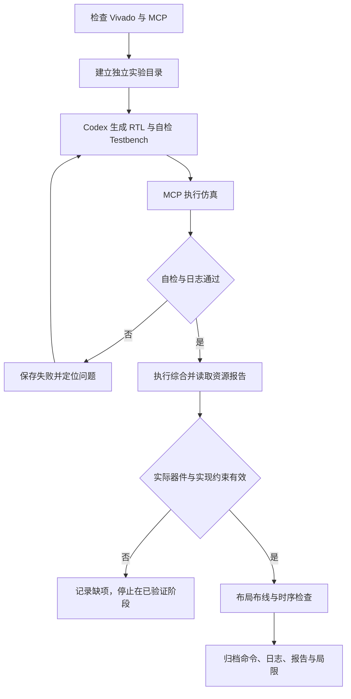

# Vivado 入门实验：Codex + MCP 计数器设计

本教程将原学习笔记中的计数器例子整理为独立实验。使用 Windows、VS Code、Codex 和 Vivado MCP，依次完成 RTL、自检仿真、综合，以及具备有效器件和约束时的实现与时序检查。本文提供的是操作方法和参考代码，不是已完成实验报告；不执行 FPGA 板卡烧录。

## 1. 实验目标

设计一个参数化无符号计数器：

- 在 `clk` 上升沿工作，`rst` 为高有效**同步复位**，优先于 `en`。
- `rst=0, en=1` 时加一；`rst=0, en=0` 时保持。
- 达到最大值后自然回绕到零。
- 使用默认 4 位进行教学，覆盖复位、保持、连续计数、溢出和复位优先级。

完成标准是取得真实证据：Testbench 自检通过、综合 Run 完成、报告可读取。Implementation 和完整时序结论还需要真实 part、有效时钟与 I/O 约束；缺少条件时记录为“未执行”或“仅部分路径分析”。



## 2. 实验环境及前置检查

先完成 [环境配置与连接验证](LLM-MCP-Vivado.md)。主要术语如下：

| 名称 | 本实验中的含义 |
| --- | --- |
| Verilog / RTL | 描述计数器触发器、复位与使能逻辑，可交给综合器生成硬件 |
| Testbench | 生成时钟和输入、比较输出的仿真程序，不作为硬件顶层进行综合 |
| Simulation | 用事件驱动仿真执行 RTL 与测试，检查功能行为 |
| Synthesis | 将 RTL 转成目标 FPGA 的逻辑网表，统计寄存器与逻辑资源 |
| Implementation | 对网表执行优化、放置和布线，得到物理实现结果 |
| Timing Report | 按约束计算路径延迟与裕量，不能脱离约束覆盖范围解释 |

在开始前记录：

1. 实际 `vivado.bat` 路径及 `-version` 输出。2018.3 可用于旧工程，但不满足本次扩展 README 的版本下限；优先使用已独立验证的新版。
2. 实际安装的器件完整 part 和授权情况。按板卡/器件资料选择，在 Vivado 中以 `get_parts -quiet` 核对；不要从示例猜测板卡型号。
3. 时钟周期、来源和分析范围。时钟频率为 MHz 时，周期 ns 等于 `1000 / 频率`。教学目标频率与实际板卡时钟不是同一件事，应明确来源。
4. `codex mcp get vivado-mcp` 中的 URL 与扩展日志一致，并已通过真实工具发现、`vivado_list_sessions` 和隔离会话的 `version` 调用。
5. 确认实验磁盘可写、空间足够。Codex 文件工具和 Vivado 必须能访问同一组路径；远程/WSL 环境还需核对文件系统和 loopback 边界。

前置条件不足就先修复连接或安装。本文不替用户选择实际 FPGA、不虚构许可证可用，也不把 `codex mcp list` 当成工具可用证明。

## 3. 创建独立测试目录

### 3.1 新建目录与文件组织

在 PowerShell 中执行，路径可按磁盘情况调整，始终使用全新目录：

```powershell
$labParent = 'D:\fpga-labs'
New-Item -ItemType Directory -Path $labParent -Force | Out-Null
$labDir = Join-Path $labParent ('counter-' + (Get-Date -Format 'yyyyMMdd-HHmmss'))
if (Test-Path -LiteralPath $labDir) { throw 'Use a new experiment directory' }
New-Item -ItemType Directory -Path $labDir -ErrorAction Stop | Out-Null
foreach ($subDir in @('rtl','tb','constraints','scripts','logs','reports','build')) {
    New-Item -ItemType Directory -Path (Join-Path $labDir $subDir) | Out-Null
}
$labDir
```

父目录的 `-Force` 只确保目录存在；不会清空它。若时间戳重名则停止，不能改用覆盖现有实验。建议用 **File → New Window → Open Folder** 打开此目录，保留当前研究工作区。

```text
counter-<本次时间戳>/
|-- rtl/counter.v
|-- tb/tb_counter.sv
|-- constraints/clock.xdc
|-- constraints/board_io.xdc     # 具备真实约束时才创建
|-- scripts/config.tcl
|-- scripts/setup.tcl
|-- scripts/run_sim.tcl
|-- scripts/report_synth.tcl
|-- scripts/report_impl.tcl
|-- logs/                       # 调用记录与完整日志索引
|-- reports/                    # 通过标记、资源与时序报告
|-- build/                      # Vivado 工程与生成结果
`-- results.json                # 实际执行后填写
```

这些文件由 Codex 按下文创建，不是创建文件夹后自动出现。源码、XDC、Tcl 应保留；缓存和编译结果留在独立实验目录，不必全部提交研究仓库。

### 3.2 创建专用 MCP 会话

先让 Codex 调用 `vivado_list_sessions` 查看已有会话，再调用 `vivado_start`：工作目录填上一步实际的 `$labDir`，`session_type` 为 `general`，`gui_mode` 为 `false`。按照实际 schema 调用，不把工具参数当作 PowerShell 命令。

记录新返回的 `session_id`；后续全部调用使用此 ID。用 `vivado_execute` 分别执行 `version`、`puts [pwd]`，确认版本与工作目录。若启动请求超时，先查会话列表和状态，避免实际上已启动却重复创建。不要关闭、重置或复用其他工程的会话。

## 4. 使用 Codex 生成简单 Verilog 计数器

### 4.1 规格与生成要求

让 Codex 在 `rtl/counter.v` 实现第 1 节的规格，要求使用非阻塞赋值、不生成额外时钟、不加入与规格无关的逻辑。下面是可以保存的参考 RTL：

```verilog
module counter #(
    parameter integer WIDTH = 4
) (
    input  wire             clk,
    input  wire             rst,
    input  wire             en,
    output reg  [WIDTH-1:0] count
);
    always @(posedge clk) begin
        if (rst)
            count <= {WIDTH{1'b0}};
        else if (en)
            count <= count + 1'b1;
    end
endmodule
```

`WIDTH` 必须大于等于 1。4 位表示范围 0～15，超过 15 后截断为 0。`always @(posedge clk)` 表示上升沿更新；`<=` 是时序逻辑的非阻塞赋值；未命中复位或使能分支时触发器保持原值。复位位于时钟过程内，因此同步复位只在上升沿生效。

### 4.2 生成后审查

检查模块名、端口、复位优先级和位宽。计数器内部不能出现 `#delay`；延迟仅用于 Testbench。默认宽度是 4，综合和测试应使用同一宽度。LLM 输出首先是一份待验证的设计，不能直接记为功能正确。

## 5. 编写自检 Testbench

### 5.1 激励、采样与通过条件

保存以下代码为 `tb/tb_counter.sv`。后缀 `.sv` 用于 SystemVerilog Testbench，RTL 文件仍为 Verilog。时钟每 5 ns 翻转一次，只定义仿真激励；实际实现频率由 XDC 决定。

```systemverilog
`timescale 1ns/1ps
module tb_counter;
    localparam integer WIDTH = 4;
    reg clk = 1'b0;
    reg rst = 1'b0;
    reg en = 1'b0;
    wire [WIDTH-1:0] count;
    integer i;
    integer pass_fd;

    counter #(.WIDTH(WIDTH)) dut (
        .clk(clk), .rst(rst), .en(en), .count(count)
    );
    always #5 clk = ~clk;

    task automatic step_check(
        input reg rst_value,
        input reg en_value,
        input reg [WIDTH-1:0] expected
    );
        begin
            @(negedge clk);
            rst = rst_value;
            en = en_value;
            @(posedge clk);
            #1; // Sample after the nonblocking assignments have settled.
            if (count !== expected)
                $fatal(1, "SIM_FAIL rst=%b en=%b expected=%h actual=%h",
                       rst_value, en_value, expected, count);
        end
    endtask

    initial begin
        // Establish known state and check reset priority over enable.
        step_check(1, 1, 4'd0);
        step_check(0, 1, 4'd1);
        step_check(0, 0, 4'd1);
        step_check(0, 0, 4'd1);
        step_check(0, 1, 4'd2);

        // A synchronous reset must not change count between clock edges.
        @(negedge clk);
        rst = 1;
        en = 1;
        #1;
        if (count !== 4'd2)
            $fatal(1, "SIM_FAIL reset acted before the rising edge");
        @(posedge clk);
        #1;
        if (count !== 4'd0)
            $fatal(1, "SIM_FAIL synchronous reset or reset priority");

        // Check every value through the 4-bit boundary.
        for (i = 1; i <= 15; i = i + 1)
            step_check(0, 1, i[WIDTH-1:0]);
        step_check(0, 1, 4'd0); // 15 -> 0 rollover
        step_check(0, 0, 4'd0);
        step_check(0, 1, 4'd1);
        step_check(1, 0, 4'd0);
        step_check(0, 0, 4'd0);

        pass_fd = $fopen("counter_sim.pass", "w");
        if (pass_fd == 0)
            $fatal(1, "SIM_FAIL cannot write pass marker");
        $fdisplay(pass_fd, "SIM_PASS counter WIDTH=4");
        $fclose(pass_fd);
        $display("SIM_PASS counter WIDTH=4");
        $finish;
    end

    initial begin
        #20000;
        $fatal(1, "SIM_FAIL watchdog timeout");
    end
endmodule
```

测试在下降沿改变输入，上升沿后延迟 1 ns 再采样，避免与非阻塞赋值的更新竞争。`!==` 会把 X/Z 也判为不匹配。`$fatal` 表示失败，watchdog 防止测试没有正常结束。只有所有检查通过后才写 `counter_sim.pass` 并输出 `SIM_PASS`。

这是固定 4 位的教学测试，不是所有参数组合的验证。改变 `WIDTH` 时应同步扩展边界值和循环；可另建实验检查 WIDTH=1、8 等参数，不能仅改 DUT 宽度后沿用固定预期。

### 5.2 自检有效性检查

Codex 应解释每组激励对应的预期值。可在**另一个临时副本**中把加一故意改为加二，确认测试能失败；不得修改正式实验基线后忘记恢复。仅看到波形变化或仿真退出都不够，通过必须同时检查标记、日志和致命错误。

## 6. 通过 MCP 调用 Vivado 执行仿真

### 6.1 确认器件与配置文件

在本次会话中用 `get_parts -quiet` 核对实际完整 part，必要时先按真实系列筛选。没有确认实际 part 时停止工程流程，不任意选一个器件当作板卡。

创建 `scripts/config.tcl`，替换两个占位符后才可执行：

```tcl
set lab_part {REPLACE_WITH_ACTUAL_PART}
set lab_period_ns {REPLACE_WITH_ACTUAL_PERIOD_NS}
```

例如周期 10 ns 对应 100 MHz，但是否使用该目标由实际实验条件决定。此文件定义工具分析目标，不代表已经测得板卡时钟。如果已有真实板级约束，可将其整理为 `constraints/board_io.xdc`，只包含与本实验端口匹配的管脚、电气和 I/O 时序约束，不重复定义 `sys_clk`。

### 6.2 创建独立 Vivado 工程

保存为 `scripts/setup.tcl`：

```tcl
set lab [file dirname [file dirname [file normalize [info script]]]]
source [file join $lab scripts config.tcl]
if {[string match REPLACE_* $lab_part]} { error {Set the actual FPGA part first} }
if {![string is double -strict $lab_period_ns]} { error {Set a numeric clock period in ns} }
if {$lab_period_ns <= 0} { error {Clock period must be positive} }
if {[llength [get_parts -quiet $lab_part]] != 1} { error {Part is not uniquely installed} }

set project_dir [file join $lab build]
if {[file exists [file join $project_dir counter_lab.xpr]]} {
    error {Project already exists; inspect it or create a new lab directory}
}
set clock_xdc [file join $lab constraints clock.xdc]
if {[file exists $clock_xdc]} { error {Clock XDC already exists; do not overwrite it} }
set fd [open $clock_xdc w]
puts $fd [format {create_clock -name sys_clk -period %s [get_ports clk]} $lab_period_ns]
close $fd

create_project counter_lab $project_dir -part $lab_part
set_property target_language Verilog [current_project]
set_property target_simulator XSim [current_project]
add_files -norecurse [file join $lab rtl counter.v]
set_property top counter [get_filesets sources_1]
add_files -fileset sim_1 -norecurse [file join $lab tb tb_counter.sv]
set_property top tb_counter [get_filesets sim_1]
add_files -fileset constrs_1 -norecurse $clock_xdc
set io_xdc [file join $lab constraints board_io.xdc]
if {[file exists $io_xdc]} {
    add_files -fileset constrs_1 -norecurse $io_xdc
}
update_compile_order -fileset sources_1
update_compile_order -fileset sim_1
puts "LAB_PROJECT_READY: [get_property NAME [current_project]]"
puts "LAB_PART: [get_property PART [current_project]]"
```

本脚本只在新实验目录创建工程和时钟 XDC，不使用 `create_project -force`。它把 `counter` 设为综合顶层，把 `tb_counter` 设为仿真顶层，避免误综合 Testbench。路径从脚本位置计算，Tcl 中尽量使用正斜杠或 `file join`。

让 Codex 通过 `vivado_execute` **单独执行**以下 Tcl，替换为实际绝对路径：

```tcl
source {D:/fpga-labs/counter-实际时间戳/scripts/setup.tcl}
```

`source`、`launch_runs`、`wait_on_run` 等命令在该版 Server 中有独立调度要求，应分别发起调用，不能在它们之前随意拼接其他命令。Server 返回 busy/任务已受理时，用 `vivado_status` 轮询，完成后再执行下一步。

### 6.3 执行自检仿真

保存为 `scripts/run_sim.tcl`，使用同一个已打开工程的专用会话：

```tcl
set lab [file dirname [file dirname [file normalize [info script]]]]
if {[get_property NAME [current_project]] ne "counter_lab"} { error {Wrong project} }
set sim_dir [file join $lab build counter_lab.sim sim_1 behav xsim]
set sim_marker [file join $sim_dir counter_sim.pass]
if {[file exists $sim_marker] || [file exists [file join $lab reports sim_pass.txt]]} {
    error {Old pass evidence exists; use a fresh experiment directory}
}
set_property xsim.simulate.runtime 0ns [get_filesets sim_1]
launch_simulation -simset sim_1 -mode behavioral
run all
if {![file exists $sim_marker]} {
    error {No fresh self-test pass marker; inspect compile, elaborate and simulation logs}
}
set fd [open $sim_marker r]
set verdict [string trim [read $fd]]
close $fd
if {$verdict ne "SIM_PASS counter WIDTH=4"} { error {Unexpected simulation verdict} }
file copy $sim_marker [file join $lab reports sim_pass.txt]
close_sim
puts "LAB_SIM_SELF_CHECK: $verdict"
```

通过 MCP 单独执行 `source {实际目录/scripts/run_sim.tcl}`。`0ns` 使初始自动运行停在起点，随后 `run all` 运行到 Testbench 正常结束或 watchdog。默认项目模式的 XSim 工作目录为 `build/counter_lab.sim/sim_1/behav/xsim`；如果实际版本使用不同目录，按编译日志修正路径，不能跳过标记检查。

`launch_simulation` 的返回不能独立证明 Testbench 通过。脚本拒绝旧的 pass 文件，避免上次成功掩盖本次失败；重做实验使用新目录，保留旧结果。遇到 `$fatal`、编译错误或标记缺失时，停止后续综合并保存失败信息。

## 7. 查看仿真结果和日志

### 7.1 结果判定与日志位置

让 Codex 查询本会话状态和错误日志，读取 `reports/sim_pass.txt`，并检查仿真目录中的编译、展开及运行日志，例如 `xvlog.log`、`xelab.log`、`xsim.log` 或该版本生成的同类文件。

**仿真通过需同时满足：**

1. 本次编译与 elaboration 成功，无阻断错误。
2. Testbench 正常完成，输出并写入 `SIM_PASS counter WIDTH=4`。
3. 没有 `SIM_FAIL`、Fatal、watchdog 超时或其他使结论无效的错误。
4. 文件时间戳、会话、RTL、Testbench 与本次实验一致。

PowerShell 可辅助读取文件，但真实仿真应通过 MCP 发起并保留调用记录：

```powershell
Get-Content -LiteralPath (Join-Path $labDir 'reports\sim_pass.txt')
$simDir = Join-Path $labDir 'build\counter_lab.sim\sim_1\behav\xsim'
Get-ChildItem -LiteralPath $simDir -Filter '*.log'
Select-String -Path (Join-Path $simDir '*.log') -Pattern 'SIM_PASS|SIM_FAIL|FATAL|ERROR'
```

搜索关键词只是辅助，必须结合上下文判断。工具输出摘要可能截断完整日志，不能只读最后一行。

### 7.2 波形与失败分析

需要观察波形时，在本次仿真结果中查看 `clk/rst/en/count`。重点看复位在上升沿生效、`en=0` 时保持、15 到 0 的回绕。GUI 是辅助证据，自动自检仍是功能门槛。

| 现象 | 排查方式 |
| --- | --- |
| 找不到模块 | 检查 source/sim fileset、文件路径、模块名和顶层 |
| 输出一直为 X | 检查时钟、复位是否真正触发，端口是否连对 |
| 比较值差一个周期 | 检查激励与采样竞争、非阻塞赋值后的采样时间 |
| 仿真不退出 | 看 watchdog、时钟和测试流程，不手动伪造 PASS |
| 有 PASS 但同时报错 | 检查旧文件、其他运行日志和时间戳；先查清错误，不能直接接受 |

## 8. 执行综合并查看资源使用报告

### 8.1 综合运行与完成门槛

只有第 7 节通过后才进入综合。综合将 RTL 映射成目标器件网表，不会运行 Testbench，也不能替代功能验证。

让 Codex 使用同一会话，将以下 Tcl **分两次工具调用**执行：

```tcl
launch_runs synth_1 -jobs 2
```

```tcl
wait_on_run synth_1
```

`-jobs 2` 是本教程的保守并行设置，可按主机资源调整。长操作期间轮询 `vivado_status`，不要重复 launch。`wait_on_run` 返回后仍需读取 Run 的 `STATUS/PROGRESS`、错误日志及输出，而不能仅凭等待结束判成功。

### 8.2 综合报告脚本

保存为 `scripts/report_synth.tcl`，综合完成后单独通过 MCP `source`：

```tcl
set lab [file dirname [file dirname [file normalize [info script]]]]
set syn [get_runs synth_1]
set status [get_property STATUS $syn]
set progress [get_property PROGRESS $syn]
puts "SYNTH_STATUS: $status"
puts "SYNTH_PROGRESS: $progress"
if {![string match {*Complete*} $status] || $progress ne "100%"} {
    error {Synthesis did not complete successfully}
}
open_run synth_1
if {[get_property TOP [get_filesets sources_1]] ne "counter"} { error {Wrong synthesis top} }
report_utilization -file [file join $lab reports utilization_synth.rpt]
report_clocks -file [file join $lab reports clocks_synth.rpt]
check_timing -verbose -file [file join $lab reports check_timing_synth.rpt]
report_timing_summary -delay_type min_max -report_unconstrained \
    -file [file join $lab reports timing_synth.rpt]
write_checkpoint [file join $lab reports counter_synth.dcp]
```

逐项读取报告中的寄存器、LUT、时钟资源以及工具警告。资源名称可能随器件系列变化，不能凭代码行数假定固定 LUT 数；4 位逻辑也不保证所有资源统计恰好为 4。综合前若发现顶层错误，应先修复工程配置，保留失败记录后在新实验中重跑。

综合时序使用估计延迟，不能当作最终 post-route 时序。只有 clock.xdc 时，外部 `rst/en/count` 的输入输出时序尚未完整约束，必须记录这一限制。

## 9. 实现与时序分析的条件和操作

### 9.1 器件与约束准入条件

进行 Implementation 前确认：

- 实际 part 已确认、已安装，并满足授权要求。
- 时钟约束与实验目标一致，`get_clocks` 和 `report_clocks` 显示正确周期。
- 若声称完整板级接口时序有效，需有真实 `board_io.xdc`：端口匹配、正确 PACKAGE_PIN/IOSTANDARD、输入输出延迟及外部时序依据。同步复位和使能在本实验中按同步输入分析。
- 不同端口的约束来自真实板卡资料和接口假设；不随机指定管脚，不虚构输入输出延迟，不添加 false path 掩盖违例，不降低 DRC 严重级别绕过问题。

如果只有时钟而没有有效外部约束，本教程默认停在综合与部分时序检查，记录缺失项。`set_input_delay`/`set_output_delay` 来自外部器件时序与板级关系，不能为了得到好看的 WNS 统一填零。即使实现可运行，也不能宣称整个接口满足时序。

有完整约束时，在 `setup.tcl` 前放入 `board_io.xdc`。如果后来才补齐，不覆盖旧实验：新建目录，复制确认过的源码与约束并重新执行，从而让综合和实现对应同一配置。

### 9.2 布局布线与报告生成

通过准入检查后，将以下命令分别经 MCP 执行：

```tcl
launch_runs impl_1 -to_step route_design -jobs 2
```

```tcl
wait_on_run impl_1
```

到 `route_design` 为止，不运行 `write_bitstream`、硬件管理器或板卡下载。通过状态和日志确认实现完成后，保存 `scripts/report_impl.tcl` 并单独 `source`：

```tcl
set lab [file dirname [file dirname [file normalize [info script]]]]
set imp [get_runs impl_1]
set status [get_property STATUS $imp]
set progress [get_property PROGRESS $imp]
puts "IMPL_STATUS: $status"
puts "IMPL_PROGRESS: $progress"
if {![string match {*Complete*} $status] || $progress ne "100%"} {
    error {Implementation did not complete successfully}
}
open_run impl_1
report_route_status -file [file join $lab reports route_status.rpt]
report_utilization -file [file join $lab reports utilization_impl.rpt]
report_drc -file [file join $lab reports drc_impl.rpt]
report_clocks -file [file join $lab reports clocks_impl.rpt]
check_timing -verbose -file [file join $lab reports check_timing_impl.rpt]
report_timing_summary -delay_type min_max -report_unconstrained \
    -file [file join $lab reports timing_post_route.rpt]
write_checkpoint [file join $lab reports counter_routed.dcp]
```

### 9.3 时序结果解释

先看布线是否完成、DRC 与 Check Timing，再看 setup 的 WNS/TNS、hold 的 WHS/THS，以及脉宽、未约束路径等报告项目。某项没有有效路径时记录为 N/A，不把缺值写成 0。

正裕量表示该报告中受对应约束检查的路径有余量，负裕量表示违例。不能只因 WNS 非负就宣布全设计达标。综合与 post-route 的结果需要分开记录；实现完成也不意味着时序已经通过。若失败，保存关键路径和约束，先解释问题再决定新实验中的修改。

本节是工具分析，不包含实际板卡时钟测量或上板功能测试。

## 10. 整理实验结果与实际命令

### 10.1 证据与结果文件

每次实验至少保留 RTL、Testbench、config.tcl、XDC、各阶段 Tcl、MCP 调用记录、完整日志路径、报告以及工具版本。用 `vivado_history` 导出命令线索；Tool Call Dashboard 记录参数和工具响应，完整日志另作索引。

在 `results.json` 中先使用以下未执行模板，再由真实证据逐项填写：

```json
{
  "lab_dir": null,
  "session_id": null,
  "vivado_version": null,
  "part": null,
  "clock_period_ns": null,
  "simulation": { "status": "not_run", "evidence": [] },
  "synthesis": { "status": "not_run", "evidence": [] },
  "implementation": { "status": "not_run", "evidence": [] },
  "timing": {
    "stage": null,
    "constraint_coverage": "not_checked",
    "wns_ns": null,
    "tns_ns": null,
    "whs_ns": null,
    "ths_ns": null
  },
  "resources": { "lut": null, "ff": null, "bram": null, "dsp": null },
  "limitations": [],
  "commands_log": null
}
```

建议状态使用 `not_run/running/passed/failed/blocked`；Run 完成但时序违例时，分别记录实现完成和 timing 失败。没有数据保留 `null`。记录实际时间戳、源码/XDC 哈希和原始报告路径，避免不同实验结果混用。

PowerShell 可计算输入哈希：

```powershell
Get-FileHash -Algorithm SHA256 -LiteralPath (Join-Path $labDir 'rtl\counter.v')
Get-FileHash -Algorithm SHA256 -LiteralPath (Join-Path $labDir 'tb\tb_counter.sv')
Get-FileHash -Algorithm SHA256 -LiteralPath (Join-Path $labDir 'constraints\clock.xdc')
```

### 10.2 命令归档格式

让 Codex 将实际执行过的操作记入 `logs/commands.md`：

| 时间与阶段 | MCP 工具与参数 | Tcl 命令或脚本 | 完成状态 | 原始日志/报告路径 |
| --- | --- | --- | --- | --- |
| 待实际填写 | 待实际填写 | 待实际填写 | 未执行 | 无 |

记录工具返回的实际错误，不假设每次调用都有 shell exit code。对于异步任务，同时保存请求受理、轮询状态和最终完成证据。实验结束后，如需释放资源只停止本次新建的会话，保留实验目录及其他会话。

相关命令可查 [AMD Vivado MCP 工具参考](https://github.com/Xilinx/ross-ai-assistant/blob/main/docs/reference/vivado-mcp-tools.md)、[launch_simulation 说明](https://docs.amd.com/r/en-US/ug835-vivado-tcl-commands/launch_simulation)、[Timing Summary 说明](https://docs.amd.com/r/2023.1-English/ug835-vivado-tcl-commands/report_timing_summary) 和 [约束完整性检查](https://docs.amd.com/r/2023.1-English/ug949-vivado-design-methodology/Checking-That-Your-Design-is-Properly-Constrained)。在线页面可能切换版本，应以实际安装版本的 `help <命令>` 核对选项，不照搬新版专属命令。

## 11. 可直接复制到 Codex 的完整实验 Prompt

先补齐下面的工作目录、part、时钟和约束来源；缺少项目允许 Codex先检查，但不允许它猜测。此 Prompt 用于执行教程，本文档整理本身不代表该实验已经运行。

```text
请按项目中的 Vivado入门实验.md，使用 VS Code + Codex + Vivado MCP
完成一次独立的 4 位参数化计数器教学实验，不修改我的其他研究工程。

我的实验条件：
- 新实验目录父路径：D:/fpga-labs（每次创建唯一子目录，不覆盖已有目录）
- Vivado 启动器：请检查实际路径和版本；不要自动使用 2018.3
- 实际 FPGA 完整 part：待我提供或从明确的本机工程/板卡资料核实
- 时钟周期及来源：待核实，不把教学示例当成板卡实际时钟
- 板级管脚、电气、I/O 延迟约束：待核实
- 已有 MCP 名称：vivado-mcp
- 现有 URL：http://127.0.0.1:18090/mcp，以扩展实际日志核对

操作要求：
1. 先只读查看现有 Codex MCP 配置，不重复添加或覆盖 vivado-mcp。
   检查真实工具目录/schema，调用 vivado_list_sessions；无法调用就报告
   连接失败层和原始错误，先修复连接，不用文字工具清单代替执行。
2. 确认 Vivado 路径、实际版本、目标器件支持和许可条件。
   缺少实际 part 或必需信息时先完成不依赖该信息的文件准备，
   明确列出缺项，停止依赖它的执行步骤，不编造器件或许可结果。
3. 新建独立实验目录，创建 rtl/tb/constraints/scripts/logs/reports/build。
   使用 vivado_start 创建 general、Tcl 模式专用会话；记录返回 ID，
   运行 version 和 puts [pwd]，只操作本次会话，不清理其他服务或进程。
4. 生成 counter.v：WIDTH>=1，默认 4 位，上升沿、高有效同步复位，
   复位优先于使能；使能加一、禁用保持、最大值回绕。
5. 生成自检 tb_counter.sv：验证同步复位、复位优先级、保持、连续计数、
   15->0 溢出、复位后再计数；下降沿驱动，上升沿更新后采样，
   使用 !== 检查 X/Z，失败 $fatal，并有 watchdog。
   只有全部检查通过才产生新的 SIM_PASS 标记，不复用旧标记。
6. 保存教程中的 config/setup/run_sim/report 脚本，并按实际路径和参数核对。
   通过 MCP 执行仿真，保留编译、展开、运行日志和真实工具返回。
   同时检查新 PASS 标记、致命错误、时间戳和会话，不仅检查命令返回。
7. 仿真通过后才执行综合，launch_runs/wait_on_run 等分别调用，
   长任务通过 vivado_status 轮询，不因请求受理而认定完成。
   检查 Run 状态、错误和顶层，生成资源、时钟及综合时序报告。
8. 只有真实 part、许可证和有效实现约束齐备后，执行至 route_design，
   生成 route status、DRC、utilization、check_timing 和 post-route timing。
   缺少有效 I/O 约束时默认停在综合，明确约束覆盖限制。
   不随机分配管脚、不把 I/O delay 填零凑通过、不添加无依据 false path。
9. 分别记录 setup WNS/TNS、hold WHS/THS、未约束路径、资源及报告阶段。
   没有数据使用 null 或 N/A；Run 完成和时序通过分开判定。
10. 输出 results.json 和 logs/commands.md，保存实际版本、part、约束来源、
    源文件哈希、完整 Tcl、MCP 调用/轮询记录、日志与报告路径、失败原因。
    如果无法完成某阶段，写明已验证部分与阻塞条件，不填造成功结果。

禁止修改本实验目录之外的工程；禁止升级旧工程/IP；禁止强制覆盖文件；
禁止生成或下载 bitstream、禁止板卡烧录；不要关闭其他会话。
需要停止时只停止本次创建且 ID 已核实的会话，保留所有证据。
最后报告每阶段是否执行、真实结果、日志路径和剩余问题。
```
